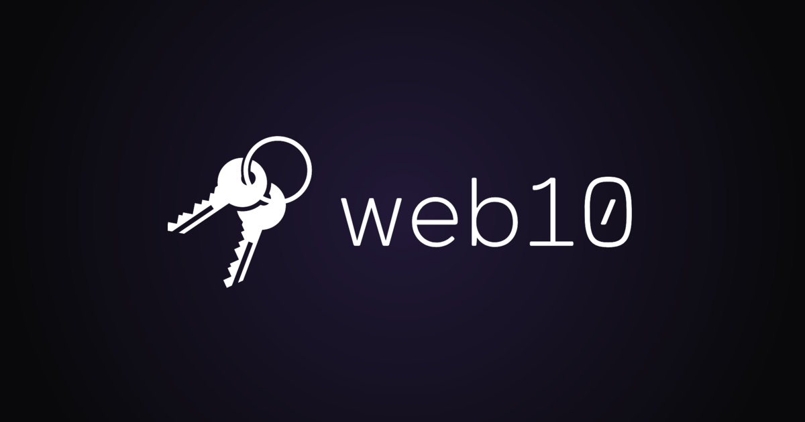

# web10

[](https://www.npmjs.com/package/web10-npm)



web10 starts from one premise: **what you make is yours.**

Every user gets their own database collection. Every record is
`{service, body}`. Apps are stateless frontends that borrow
access through a scoped, expiring token, do their work, and step aside.
The data outlives any app, because the data was never the app's to keep.

On that protocol stands the product: **a platform for creators who refuse
to rent their own audience.** Today a creator with a million subscribers
reaches three hundred thousand — not by accident, but by design. The
platform withholds your reach so it can sell it back to you. web10 removes
the landlord. On your own node, a post reaches 100% of your followers,
delivered to each one's inbox the moment you publish. There is no algorithm
to please, no throttle to buy your way past, no shadow ban to fear. This
is not a promise written in a policy that can be revised. It is the
architecture, and architecture cannot be quietly revoked.

The model is WordPress, applied to social media: open, self-hostable
nodes. Creators run them, under their own name and their own domain, and
keep what they earn. Accounts are free for their audience. web10 takes a
small percentage of the revenue that moves through its payment rails —
paid for value delivered, not for permission granted.

## The premise, made concrete

| | |
| --- | --- |
| **You own your data** | One collection per user — the record of your own life, held by you. Export it, move it, erase it. Delete means delete. |
| **No shadow ban** | Every post reaches every follower, by construction (fan-out on write). Delivery is 100% — and how the reader ranks what they see is the reader's own choice, not the platform's. |
| **Apps write their own queries** | The node ships a query engine: the app's read SQL is compiled against the reader's grants, and the string itself never executes. A new read pattern is a new query, not a new backend. |
| **Built like the best, owned like yours** | web10 uses PostHog for usage analytics and optional content-masked replay/heatmaps to compete on experience. Your content is never tracked, sold, or fed to an ad machine; the trade is stated in the terms (D56/D103). |
| **Apps are just frontends** | An app earns access through a scoped, expiring, revocable token. It never owns what it touches. |
| **Federated identity** | Identity is `(username, provider)`, like email. No central registry to petition, no account that can be taken from you. |
| **Private, not permanent** | Unlike a blockchain, your data can be private, temporary, and deletable. You set who sees it via terms — and delete means delete. |
| **Self-hostable** | One `docker compose up` runs a node on hardware you own. The escape hatch is real, and that is what makes the ownership real. |

## How it works

The node is small on purpose. One ClickHouse `documents` table holds the
data of every user on it — each record is `{service, body}`, keyed by
`(author_key, doc_id)` — and everything else is a policy engine on top:

- **Groups and grants** decide who can read or write which service.
  "Make my profile public" is one row: a reserved `anyone` principal with
  a read grant on the `profile` service. The API has no app concepts —
  it stays generic on purpose.
- **Apps get scoped, expiring tokens** (`username, site, target,
  provider, expires`). The node verifies the signature and re-checks the
  grants on every read: a token is a claim, not a key to the vault.
- **The query engine** is how apps read at scale: the app writes its own
  SQL over its services, and the node compiles it against what this
  particular reader may see.
- **Media lives in S3-compatible storage** (MinIO on the reference node);
  delivery URLs are signed and expire.
- **Federation is the client's job.** Identity is `(username, provider)`;
  cross-node token checks happen over `/certify` — an email-style
  handshake, not a registry. A multi-node feed is a union of
  independently authorized reads, and a node never queries another node's
  database.

The contracts live in [`knowledge-base/web10-v3/`](knowledge-base/web10-v3/):
`db/clickhouse.md` (the data model), `auth/auth.md` (tokens and consent),
`query-engine.md` (the read gate), `groups/access.md` (grants), and
[`strategy/multi-node.md`](knowledge-base/strategy/multi-node.md)
(federation).

## Run a node locally

Requirements: Docker.

```bash
git clone https://github.com/jacoby149/web10
cd web10
docker compose up --build
```

The node is the whole platform — database, API, Authenticator, media
storage — in one Compose stack. Open **http://auth.localhost**: the first
visit is the **setup wizard** (node identity → admin account → the signup
gates, beta code / phone / subscription — all off is an open node → the
storage wiring). Complete it and you're logged in as the node's admin;
from there, users sign up.

No config archaeology — settings are environment variables, with working
defaults (the full list is `api/app/settings.py`). The stack includes:

- **proxy** — routes the `*.localhost` vhosts so the browser experience just works
- **api** — the node itself: data, auth, billing, media, and the query engine (`api.localhost`)
- **ui** — the Authenticator: setup wizard, signup/login, consent, contracts, node admin (`auth.localhost`)
- **clickhouse** — the v3 database (schema init from `clickhouse-init/`)
- **minio** — S3-compatible blob storage for media
- **rtc** — WebRTC signaling (`rtc.localhost`)
- **sdk** — serves `wapi.js` and the SDK demos (`sdk.localhost`)

Bring your own ClickHouse? Set `CLICKHOUSE_HOST` / `CLICKHOUSE_PORT` /
`CLICKHOUSE_DATABASE` / `CLICKHOUSE_USER` / `CLICKHOUSE_PASSWORD`
(`CLICKHOUSE_SECURE` when it's over TLS). If something else owns port 80
on your machine, `WEB10_HTTP_PORT` moves the local proxy.

## Deploy to a server

`ubuntu-deployment/` runs a whole node on one Linux box: one
parameterized compose file (`docker-compose.ecosystem.yml`) deployed as
two Portainer stacks — **dev** (LAN/VPN-only; merged work soaks here
under real DNS names) and **prod** (the public node) — with Nginx Proxy
Manager terminating TLS and Cloudflare doing the DNS. The deployment is
idempotent code in `ubuntu-deployment/scripts/`, driven by GitHub
Actions. See [`ubuntu-deployment/README.md`](ubuntu-deployment/README.md).

## What's in this repo

| directory | what it is |
| --- | --- |
| `api/` | FastAPI — the node. All data + auth + billing + media, and the query engine. |
| `api/rtc/` | WebRTC signaling server (P2P data channels — messages run on it). |
| `ui/` | The Authenticator — React: setup wizard, signup/login, consent, contracts, node admin. |
| `sdk/` | `wapi.js` (`web10-npm`), the frontend library web10 apps are built with. |
| `marketing/web10-social/` | The killer app: all-in-one social lens — feed, profiles, DMs, media, video + streaming. |
| `marketing/marketing-ui/` | web10 Inc.'s site: landing, docs, App Store, creator discovery. |
| `marketing/web10-cli/` | CLI tool for web10. |
| `marketing/shared/` | Shared modules (telemetry, discover, appearance) used across the marketing surfaces and web10-social. |
| `marketing-importing/` | OPS: the headless creator-import pipeline (Instagram → web10) — `web10identify` / `web10import` / `web10accountsync`. |
| `clickhouse-init/` | v3 schema initialization for the node's ClickHouse. |
| `media-delivery/` | Protected CDN media delivery — edge-verified capabilities, off by default. |
| `ubuntu-deployment/` | Server deploy: one box, Portainer + Nginx Proxy Manager + Cloudflare. |
| `e2e/` + `scripts/` | End-to-end test stack and helpers. |
| `knowledge-base/` | The project's brain — the v3 contracts, the strategy (plan, decisions, design standard, manifest), the changelogs, and written security. |
| `ai-pack/` | The portable AI method — how agents (and people) work with this codebase. |
| `research/` | The paper — "Your Data, Your Rules: Extending the Decentralized Web." (SIGMOD 2027 industry track) — plus the experiment harness. |

The marketing site and social app call the node API directly for reporting
and analytics. There is no separate marketing API service (D91).

## Contributing

Docs first, then code: [`knowledge-base/`](knowledge-base/README.md) is the
root of trust — the contracts, the plan, and the decisions are what the
implementation follows — and [`AGENTS.md`](AGENTS.md) is the operating
manual for working in this repo (yes, the AI agents read it too; this codebase
is built with them).

- PRs target **`dev`**; merge small, merge often. `main` only by deliberate promotion.
- Branch naming: `feature/`, `fix/`, `refactor/`, `docs/`, `chore/`, `test/`.
- The permission-matrix test suite is the seatbelt — nothing merges red.
- UI work follows [`strategy/design.md`](knowledge-base/strategy/design.md); every change ships with a line in [`knowledge-base/changelogs/CHANGELOG.md`](knowledge-base/changelogs/CHANGELOG.md).
- By submitting work you agree to the [Contributor Agreement](<web10 Contributor Agreement.pdf>).

## Learn more

- **[`knowledge-base/`](knowledge-base/README.md)** — where to start
  understanding web10: the v3 contracts, the strategy docs, the changelogs,
  and written security, with a suggested reading order.
- **[`strategy/plan.md`](knowledge-base/strategy/plan.md)** — the roadmap
  and the why.
- **[`strategy/decisions.md`](knowledge-base/strategy/decisions.md)** — why
  the big calls were made.
- **[`strategy/manifesto.md`](knowledge-base/strategy/manifesto.md)** — the
  fan-facing pitch that ships on every node.
- **[`changelogs/CHANGELOG.md`](knowledge-base/changelogs/CHANGELOG.md)** —
  what shipped and why, newest first.
- **The paper** — [research strategy and maps](research/README.md) · the
  [working manuscript](research/sixth-draft/main.pdf) · the
  [decentralized-IAM thesis](research/decentralized-iam-thesis.md) that is
  the paper's spine.
- **[`strategy/SECURITY.md`](knowledge-base/strategy/SECURITY.md)** — how to
  report vulnerabilities, and the security invariants (I1–I6) that define
  what a break means.
- **Developer docs** — protocol spec, conventions, schemas:
  `marketing/marketing-ui/public/docs/` (live at [web10.app/docs](https://www.web10.app/docs)).
- **SDK** — `npm install web10-npm` · [npm](https://www.npmjs.com/package/web10-npm) · [docs](https://www.web10.app/docs/sdk)

## Community

- Live node: https://web10.app · social app: https://social.web10.app
- Discord: https://discord.gg/Dbd4VEDznU

## License

The web10 node is licensed under the **Server Side Public License v1 (SSPL-1.0)** — see [`LICENSE`](LICENSE).

SSPL is a strong copyleft license. In plain terms:

- **Run it, self-host it, build on it — free.** You may run an unmodified web10 node, modify it for your own use, and build apps on top of it. No license key, no fee, no cap.
- **The one condition (Section 13):** if you offer a *modified* web10 to others **as a service**, you must release your Service Source Code under the same license. Running your own node — even a big one, even commercially — does not trigger this; you're *running* the software, not *conveying* a modified version.
- **The copyright line in `LICENSE` says "MongoDB, Inc."** on purpose. That line is the copyright in the *license text itself* (SSPL was authored by MongoDB). web10's copyright is asserted on the web10 source code, not on the license document. The SSPL forbids altering the license text, so it is reproduced verbatim.

SSPL is **source-available**, not OSI-approved open source — the same category MongoDB's own server sits in. web10's hosted-node offering is the commercial service; the software stays free to run and extend.

web10 is built for people whose work carries their name. If the idea
earns your respect, star the repo. Better — run a node, and build
something you'd sign.
