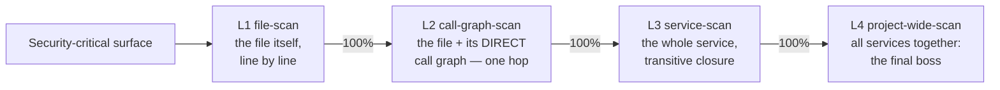

# AI Security Theory

This is how you make security *real* with AI — not "point a model at the code and hope,"
but a process that ends with a **dated record**: what was checked, by what, when, what
was found, what was fixed, and that it was confirmed after. That record is the
**security record**, and it lives in `knowledge-base/security/` alongside the rest of
the project's written security (the plan, the knowledge, the decisions).

It's the security sibling of [AI Use Theory](../ai-use-theory/README.md): that one is
about fixing a *bug* (find the break, fix it, test green); this one is about hardening
a *surface* (check everything, fix every hole, and be able to show it).

Two things keep it honest: the **security record** (what was checked, when, by what) and
the **learnings** (what we've figured out — the rules we're protecting, every fix, the
gaps, and the things we decided *not* to do). You read the learnings before you scan,
and every fix writes back to them — so each pass starts smarter than the last. See
[the-orient/](./the-orient/README.md).

## Start here: the post-mortem

[security-post-mortem/](./security-post-mortem/README.md) is the story this whole
theory exists to prevent — the 1157/1159 giant-PR failure, told the way
[ai-use-theory opens on the money-bleed](../ai-use-theory/ai-use-theory.md). Read
it first. It ends on the beat that justifies everything below: *you burned a ton,
you're not even sure it's fixed, and you'd have to scan it all over again anyway —
because there was no security record confirming what was checked with what model.*

## The point, in plain terms

Why bother? Because of what you *walk away with.*

When you pay a pentest firm, they look at your code, try to break it, and hand you
something specific: *"we tested this, on this date, we found these holes, they're
fixed now, and we checked again and it looks good."* That's a **promise you can hold
someone to.** It's peace of mind with a date on it.

Just pointing an AI at your code doesn't give you that. You get a bunch of changes
and a hope. No one can say *what* was checked, *when*, or *that it was actually
fixed.* It's vibes, not a guarantee.

This is how you get the pentest promise — but better. It doesn't just find the
holes; **it fixes them too.** A human pentest stops at the report ("here are the
problems, go fix them"). This does the finding *and* the fixing — the actual software
work that comes after. And every step gets written down, so at the end you have the
same dated promise: *what was checked, by what, when, what was found, what was fixed,
and that it was confirmed after.*

So the measure of success isn't "how much code did we change" or "what percentage did
we scan." It's simpler: **what holes did we find, and did we close them?** A ship that
was scanned top to bottom but still has a hole in the hull is still taking on water.
Scanning is how you make sure you don't *miss* a hole. Closing the holes — and being
able to show it — is the point.

## The scope ladder (not two engines)

Security scanning is **one activity at four zooms**, not two different engines. You
run the same line-by-line, recorded scan at each level, one at a time, each to 100%
before the next:

| Level | Scope | Catches |
|---|---|---|
| **L1 file-scan** | the file itself, line by line | the basic basics — secret in source, unsigned decode, missing origin check, no auth gate, token in a log |
| **L2 call-graph-scan** | the file + its **direct** call graph (one hop) | the edge vuln — source and sink **one hop apart**, no check between |
| **L3 service-scan** | the whole service / library / module | the transitive vuln — source and sink **several hops apart**; the intra-service pattern |
| **L4 project-wide-scan** | the whole project (all services) | the final boss — the cross-service architecture: federation, the coordinated deploy |

The **L2/L3 boundary is the hop count** (one hop = L2, more = L3) — that's what
keeps the rungs from collapsing. Full detail in
[the-scope-ladder/](./the-scope-ladder/README.md). The ladder is run **backend-first**
(the criticality gradient — a backend vuln needs no human to exploit; a frontend
one does). The signature list the scan checks against is
[the-scope-ladder/the-checklist.md](./the-scope-ladder/the-checklist.md).

## Orient first (the security Phase 1)

You do **not** start by scanning. You start by reading the learnings KB and running
three prompts — **onboarding** (what's been considered), **recession** (did any
invariant / handled thing quietly break again), and **the obvious gap**
(assumption-enumerate the invariants; is there a threat class we aren't even
naming?). Then every fix **writes back** to the learnings, so the next orient is
smarter. This is the piece that makes the theory lean on the KB the way the
use-theory does — see [the-orient/](./the-orient/README.md).

## The exploit is the test (exploit-first)

The security unit test is **an exploit** — a working hack, not an assertion of
intended behavior. The workflow is **exploit-first**: build the exploit → it works
(**red** = the vuln is real) → fix → the same exploit is denied (**green** = the hole
is closed). The exploit is the primary artifact, and it has a dual life: it is the
**proof** the finding is real (it kills the false positive) and the **pinning test**
that guards against regression. One artifact, three jobs: proof, repro-gate,
ratchet. **A finding is not real until you can demonstrate it** — a scanner that says
"this looks vulnerable" without a working exploit is guessing, and that is the
sycophancy the whole theory exists to kill. This is the same idea as the use-theory's
**anti-test** ("the KB with teeth") and the **hacker-model gauntlet** in
`scans/late-stage/` — the repro gate is that idea made a close-condition. Full
treatment in [the-security-record/](./the-security-record/README.md).

## The gate: passing the AI pentest

When **L1 + L2 + L3 + L4 are all done** — every part checked, every hole fixed (or
deliberately parked), every fix verified — the surface has **passed the AI pentest.**
That's the done-state, and it's a claim the security record backs. See
[the-pentest-gate/](./the-pentest-gate/README.md).

**How it compares to hiring a human pentest ($5k–$30k, ~$18k average):** a human
pentest looks at your code, tries to break it, hands you a report, and leaves. You
still have to do the fixing yourself, and next year you pay them again for a fresh
look. This does the same checking *and* the fixing, writes the whole thing down, and
you can re-run it on a schedule (every 3–6 months) instead of re-hiring. And it gets
better each time: the fixes are locked in with tests (so they don't sneak back), and
each pass uses a smarter model that already knows what the last pass learned. So where
a human pentest is a one-time snapshot, this is a check that keeps getting stronger —
and you always have the dated record of exactly what was done.

## The map

| Directory | What it covers |
|---|---|
| [security-post-mortem/](./security-post-mortem/README.md) | Why the old way fails — the 1157/1159 story, the money-bleed, the no-peace-of-mind ending, and the merge-breakage closer |
| [the-orient/](./the-orient/README.md) | Phase 1 — read the learnings KB first: onboarding, recession, the obvious gap (assumption-enumeration), and the write-back that makes the next orient smarter |
| [the-scope-ladder/](./the-scope-ladder/README.md) | L1 file-scan → L2 call-graph-scan → L3 service-scan → L4 project-wide-scan, the hop-count L2/L3 boundary, and the criticality gradient. Plus [the-checklist.md](./the-scope-ladder/the-checklist.md), the signature list (Python/JS-shaped, by threat class) |
| [the-security-record/](./the-security-record/README.md) | The altitude — the format, PASS/OPEN/STALE + the deferral reference + the **repro gate** (how a finding closes), freestyle granularity. Plus [staleness-and-cadence.md](./the-security-record/staleness-and-cadence.md), relative staleness + the 3–6 month clock + the ratchet |
| [the-pentest-gate/](./the-pentest-gate/README.md) | The done-state — what "passed the AI pentest" means, and why it beats a human pentest ($5k–$30k) |
| [the-gauntlet/](./the-gauntlet/README.md) | **The enforcement** — the security gauntlet (the accumulated exploits, run in CI on every PR like the e2e gauntlets) + the per-PR gate (≤500 lines, red→green test, security record updated). The "wrong way doesn't merge" piece |
| [the-design-intent-gate/](./the-design-intent-gate/README.md) | **The maintains-product-functionality review** — the five-question check (intent, delta, by-design conflict, conventional-standard deviation, untested intent risk) that proves a security fix didn't over-secure or quietly change the product. The "we are doing different, not standard" piece |
| [running-it/](./running-it/README.md) | The operation — orient, scope slicing backend-first, the scan→fix PR flow (exploit-first + repro gate + write-back), the L1→L2→L3→L4 order, the **convergence review** (fresh untainted reviewer, run until 3-dry, with model diversity), the **design-intent gate**, and the enforceable rules |

## The rules (the enforceable summary)

1. **No security PR over 500 lines. Target ~100.** One finding = one fix PR.
2. **The scan is read-only.** It produces a security record PR + backlog tasks, never code.
3. **Orient before you scan.** Read the learnings KB, check recession + the gap. A
   scan without an orient is blind.
4. **L1 → L2 → L3 → L4, each to 100% before the next, backend-first.** The zooms,
   in order, the crown jewels first.
 5. **Every fix passes the repro gate** — the exploit replayed, denied, red-then-
    green. **By determinism, not level:** a **deterministic exploit at any level
    (L1–L4)** whenever feasible; a **scrutinized explanation only when genuinely
    non-deterministic** (usually L3/L4 — the exact sequence, why it's real, what
    prevents it — adversarially checked by other agents). Don't lazily default L3/L4
    to the explanation.
6. **Every result writes back to the KB** — a fix *and* a failed exploit (a
   confirmed non-vulnerability is a learning, not a discarded false positive).
7. **Re-scan on a 3–6 month cadence, on a stronger model.** Staleness is relative;
   the cadence is the clock; the model upgrade is the third ratchet.
8. **Trust-boundary units need the convergence review** — three consecutive dry
   passes by a fresh, untainted reviewer, **across different model families** (the
   `model=` field is the hook for diversity — the union of several brains beats one).
   A PASS without three-dry is a claim, not a verification.
9. **The gauntlet + gate enforce it.** The accumulated exploits run in CI on every
   PR (a regression fails the build); a trust-boundary PR must pass the gate (≤500
   lines, red→green test or scrutinized explanation, security record updated). The wrong way
   doesn't merge.
10. **Every trust-boundary / security PR passes the design-intent gate.** A fresh
    reviewer answers the five questions (intent, delta, by-design conflict,
    conventional-standard deviation, untested intent risk) and posts the
    `DESIGN-INTENT REVIEW` block. A security fix is not done when the exploit is
    denied — it is done when the exploit is denied **and** the app still behaves
    like the product the KB describes. See
    [the-design-intent-gate/](./the-design-intent-gate/README.md).

*(And: parallelize the scan, not the fix — ~40 read-only scanners at once across the
core, fix PRs one finding at a time. That's what makes it a quick win, not a
program.)*

## Where the state lives

The *method* is here (portable — drop it in any repo). The *state* — the actual
security record, the scan records, and the big-picture backlog — lives in the per-repo
knowledge base, e.g. `knowledge-base/security/`. The method tells you how; the
knowledge base records what.
