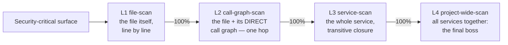

# AI Security Theory

The **security record** is the root of trust: a dated, agent-attributed log of what
was scanned, by which model, when, against what commit, and what was found. It does
*not* guarantee security — it records the **due diligence**, so you can say "here is
the level of security we actually did." This is the methodology for hardening a
codebase with AI so that security is **coverage you can point at**, not a 90-file PR
merged on faith. The record is the *record* piece of **written security** (WS) — the
whole `knowledge-base/security/` section, which is strategy + record + knowledge.

It is the security sibling of [AI Use Theory](../ai-use-theory/README.md): where
the use-theory converges a *bug* (find the break, fix it, test green), the security
theory covers a *surface* (scan every line, fix every finding, and be able to prove
both from the record).

> **The one assumption:** *a surface is only as secure as its last scan.* You cannot
> claim a file is secure until the record says it was scanned — by which model, on
> what date, against which commit. The KB tells you what the system is *supposed* to
> guarantee (the invariants); the record tells you what has actually been *checked*
> against those guarantees, and when.
>
> There are **two roots of trust**, and they are different: the **security record**
> records *coverage* (what was scanned, when, by what model); the **learnings** KB
> records *knowledge* (the invariants as they've evolved, every finding→fix, the gaps,
> the "considered and declined" list).
> "considered and declined" list). You orient against the learnings before you scan,
> and every fix writes back to them — see [the-orient/](./the-orient/README.md).

## Start here: the post-mortem

[security-post-mortem/](./security-post-mortem/README.md) is the story this whole
theory exists to prevent — the 1157/1159 giant-PR failure, told the way
[ai-use-theory opens on the money-bleed](../ai-use-theory/ai-use-theory.md). Read
it first. It ends on the beat that justifies everything below: *you burned a ton,
you're not even sure it's fixed, and you'd have to scan it all over again anyway —
because there was no security record confirming what was checked with what model.*

## The reframe in one paragraph

A security-hardening task has no bounded scope and no provable *done* — "there
are no more vulnerabilities" can never be shown, only *covered*. Hand that
open-ended task to an agent and you get the security-flavored doom loop: it claws
at an unbounded surface and ships a sprawl. The fix is to stop treating security
as a *convergence* task and treat it as a **coverage** task. What you can measure
is coverage — what fraction of the trust surface has been scanned, at what level,
and what fraction of the findings are fixed. Coverage is recorded and monotonic.
**Forward progress on security = the security record fills up and the backlog drains, both
monotonically, and you can point at the security record and show it.**

## The scope ladder (not two engines)

Security scanning is **one activity at four zooms**, not two different engines. You
run the same line-by-line, recorded scan at each level, one at a time, each to 100%
before the next:

| Level | Scope | Catches |
|---|---|---|
| **L1 file-scan** | the file itself, line by line | the basic basics — secret in source, unsigned decode, missing origin check, no auth gate, token in a log |
| **L2 call-graph-scan** | the file + its **direct** call graph (one hop) | the edge vuln — source and sink **one hop apart**, no check between |
| **L3 service-scan** | the whole service / library / module | the transitive vuln — source and sink **several hops apart**; the intra-service pattern |
| **L4 project-wide-scan** | the whole project (all services) | the final boss — the cross-service architecture: federation, the coordinated deploy |

The **L2/L3 boundary is the hop count** (one hop = L2, more = L3) — that's what
keeps the rungs from collapsing. Full detail in
[the-scope-ladder/](./the-scope-ladder/README.md). The ladder is run **backend-first**
(the criticality gradient — a backend vuln needs no human to exploit; a frontend
one does). The signature list the scan checks against is
[the-scope-ladder/the-checklist.md](./the-scope-ladder/the-checklist.md).

## Orient first (the security Phase 1)

You do **not** start by scanning. You start by reading the learnings KB and running
three prompts — **onboarding** (what's been considered), **recession** (did any
invariant / handled thing quietly break again), and **the obvious gap**
(assumption-enumerate the invariants; is there a threat class we aren't even
naming?). Then every fix **writes back** to the learnings, so the next orient is
smarter. This is the piece that makes the theory lean on the KB the way the
use-theory does — see [the-orient/](./the-orient/README.md).

## The exploit is the test (exploit-first)

The security unit test is **an exploit** — a working hack, not an assertion of
intended behavior. The workflow is **exploit-first**: build the exploit → it works
(**red** = the vuln is real) → fix → the same exploit is denied (**green** = the hole
is closed). The exploit is the primary artifact, and it has a dual life: it is the
**proof** the finding is real (it kills the false positive) and the **pinning test**
that guards against regression. One artifact, three jobs: proof, repro-gate,
ratchet. **A finding is not real until you can demonstrate it** — a scanner that says
"this looks vulnerable" without a working exploit is guessing, and that is the
sycophancy the whole theory exists to kill. This is the same idea as the use-theory's
**anti-test** ("the KB with teeth") and the **hacker-model gauntlet** in
`scans/late-stage/` — the repro gate is that idea made a close-condition. Full
treatment in [the-security-record/](./the-security-record/README.md).

## The gate: passing the AI pentest

When **L1 + L2 + L3 + L4 are all passed** — every unit recorded, every finding
fixed or explicitly deferred, every fix passing the **repro gate** (the exploit
replayed and denied) — the surface has **passed the AI pentest.** That is the
done-state, and it is a claim the security record backs. See
[the-pentest-gate/](./the-pentest-gate/README.md).

The pitch: this is the **alternative to hiring a human pentest ($5k–$30k, ≈$18k
average)** — and potentially *more* thorough, because it is recorded (you can point
at what was checked, by which model, when), repeatable (re-run on the 3–6 month
cadence, not a one-off report), and it **ratchets three ways** — pinning tests (a fix
can't regress), the re-scan (drift is caught), and the **model upgrade** (each pass
runs on a stronger model than the last, inheriting every learning). A human pentest
hands you a PDF and leaves; this leaves you a **living coverage record** that gets more
secure every cycle. The AI is never a true oracle — but the ratchet means you don't
need one: **every play of the game is strictly more secure than the last.**

## The map

| Directory | What it covers |
|---|---|
| [security-post-mortem/](./security-post-mortem/README.md) | Why the old way fails — the 1157/1159 story, the money-bleed, the no-peace-of-mind ending, and the merge-breakage closer |
| [the-orient/](./the-orient/README.md) | Phase 1 — read the learnings KB first: onboarding, recession, the obvious gap (assumption-enumeration), and the write-back that makes the next orient smarter |
| [the-scope-ladder/](./the-scope-ladder/README.md) | L1 file-scan → L2 call-graph-scan → L3 service-scan → L4 project-wide-scan, the hop-count L2/L3 boundary, and the criticality gradient. Plus [the-checklist.md](./the-scope-ladder/the-checklist.md), the signature list (Python/JS-shaped, by threat class) |
| [the-security-record/](./the-security-record/README.md) | The altitude — the format, PASS/OPEN/STALE + the deferral reference + the **repro gate** (how a finding closes), freestyle granularity. Plus [staleness-and-cadence.md](./the-security-record/staleness-and-cadence.md), relative staleness + the 3–6 month clock + the ratchet |
| [the-pentest-gate/](./the-pentest-gate/README.md) | The done-state — what "passed the AI pentest" means, and why it beats a human pentest ($5k–$30k) |
| [the-gauntlet/](./the-gauntlet/README.md) | **The enforcement** — the security gauntlet (the accumulated exploits, run in CI on every PR like the e2e gauntlets) + the per-PR gate (≤500 lines, red→green test, security record updated). The "wrong way doesn't merge" piece |
| [running-it/](./running-it/README.md) | The operation — orient, scope slicing backend-first, the scan→fix PR flow (exploit-first + repro gate + write-back), the L1→L2→L3→L4 order, the **convergence review** (fresh untainted reviewer, run until 3-dry, with model diversity), and the enforceable rules |

## The rules (the enforceable summary)

1. **No security PR over 500 lines. Target ~100.** One finding = one fix PR.
2. **The scan is read-only.** It produces a security record PR + backlog tasks, never code.
3. **Orient before you scan.** Read the learnings KB, check recession + the gap. A
   scan without an orient is blind.
4. **L1 → L2 → L3 → L4, each to 100% before the next, backend-first.** The zooms,
   in order, the crown jewels first.
 5. **Every fix passes the repro gate** — the exploit replayed, denied, red-then-
    green. **By determinism, not level:** a **deterministic exploit at any level
    (L1–L4)** whenever feasible; a **scrutinized explanation only when genuinely
    non-deterministic** (usually L3/L4 — the exact sequence, why it's real, what
    prevents it — adversarially checked by other agents). Don't lazily default L3/L4
    to the explanation.
6. **Every result writes back to the KB** — a fix *and* a failed exploit (a
   confirmed non-vulnerability is a learning, not a discarded false positive).
7. **Re-scan on a 3–6 month cadence, on a stronger model.** Staleness is relative;
   the cadence is the clock; the model upgrade is the third ratchet.
8. **Trust-boundary units need the convergence review** — three consecutive dry
   passes by a fresh, untainted reviewer, **across different model families** (the
   `model=` field is the hook for diversity — the union of several brains beats one).
   A PASS without three-dry is a claim, not a verification.
9. **The gauntlet + gate enforce it.** The accumulated exploits run in CI on every
   PR (a regression fails the build); a trust-boundary PR must pass the gate (≤500
   lines, red→green test or scrutinized explanation, security record updated). The wrong way
   doesn't merge.

*(And: parallelize the scan, not the fix — ~40 read-only scanners at once across the
core, fix PRs one finding at a time. That's what makes it a quick win, not a
program.)*

## Where the state lives

The *method* is here (portable — drop it in any repo). The *state* — the actual
security record, the scan records, and the big-picture backlog — lives in the per-repo
knowledge base, e.g. `knowledge-base/security/`. The method tells you how; the
knowledge base records what.
