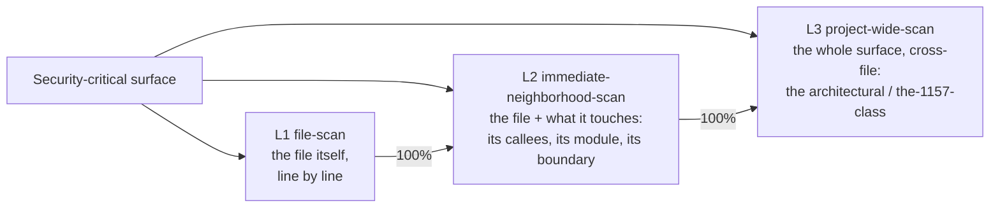

# AI Security Theory

The ledger is the root of trust for security. Everything else — the scan, the
fix, the backlog — checks against it. This is the methodology for hardening a
codebase with AI so that security is **coverage you can point at**, not a
90-file PR merged on faith.

It is the security sibling of [AI Use Theory](../ai-use-theory/README.md): where
the use-theory converges a *bug* (find the break, fix it, test green), the
security theory covers a *surface* (scan every line, fix every finding, and be
able to prove both from the ledger).

> **The one assumption:** *a surface is only as secure as its last scan.* You
> cannot claim a file is secure until the ledger says it was scanned — by which
> model, on what date, against which commit. The ledger is the root of trust for
> every security claim. The KB tells you what the system is *supposed* to
> guarantee (the invariants); the ledger tells you what has actually been
> *checked* against those guarantees, and when.

## Start here: the post-mortem

[security-post-mortem/](./security-post-mortem/README.md) is the story this whole
theory exists to prevent — the 1157/1159 giant-PR failure, told the way
[ai-use-theory opens on the money-bleed](../ai-use-theory/ai-use-theory.md). Read
it first. It ends on the beat that justifies everything below: *you burned a ton,
you're not even sure it's fixed, and you'd have to scan it all over again anyway —
because there was no ledger confirming what was checked with what model.*

## The reframe in one paragraph

A security-hardening task has no bounded scope and no provable *done* — "there
are no more vulnerabilities" can never be shown, only *covered*. Hand that
open-ended task to an agent and you get the security-flavored doom loop: it claws
at an unbounded surface and ships a sprawl. The fix is to stop treating security
as a *convergence* task and treat it as a **coverage** task. What you can measure
is coverage — what fraction of the trust surface has been scanned, at what level,
and what fraction of the findings are fixed. Coverage is ledgered and monotonic.
**Forward progress on security = the ledger fills up and the backlog drains, both
monotonically, and you can point at the ledger and show it.**

## The scope ladder (not two engines)

Security scanning is **one activity at three zooms**, not two different engines.
You run the same line-by-line, ledgered scan at each level, one at a time, each to
100% before the next:

| Level | Scope | Catches |
|---|---|---|
| **L1 file-scan** | the file itself, line by line | the basic basics — secret in source, unsigned decode, missing origin check, no auth gate, token in a log |
| **L2 immediate-neighborhood-scan** | the file + its callees, its module, the boundary it sits on | "the bug lives in the helper" — the finding that only makes sense with the neighbor in view |
| **L3 project-wide-scan** | the whole surface, cross-file | the architectural — the federation key model, the coordinated rollout, "these services must deploy together or the guarantee is broken" |

Full detail in [the-scope-ladder/](./the-scope-ladder/README.md). The signature
list the scan checks against is [the-scope-ladder/the-checklist.md](./the-scope-ladder/the-checklist.md).

## The gate: passing the AI pentest

When **L1 + L2 + L3 are all passed** — every unit ledgered, every finding fixed or
explicitly deferred, every fix pinned by a test — the surface has **passed the AI
pentest.** That is the done-state, and it is a claim the ledger backs. See
[the-pentest-gate/](./the-pentest-gate/README.md).

The pitch: this is the **alternative to hiring a $100k+ human pentest** — and
potentially *more* thorough, because it is ledgered (you can point at what was
checked, by which model, when), repeatable (re-run on the 3–6 month cadence, not a
one-off report), and it ratchets (pinning tests mean it only gets more secure). A
human pentest hands you a PDF and leaves; this leaves you a **living coverage
record.**

## The map

| Directory | What it covers |
|---|---|
| [security-post-mortem/](./security-post-mortem/README.md) | Why the old way fails — the 1157/1159 story, the money-bleed, the no-peace-of-mind ending, and the merge-breakage closer |
| [the-scope-ladder/](./the-scope-ladder/README.md) | L1 file-scan → L2 immediate-neighborhood-scan → L3 project-wide-scan. Plus [the-checklist.md](./the-scope-ladder/the-checklist.md), the signature list |
| [the-ledger/](./the-ledger/README.md) | The altitude — the format, PASS/OPEN/STALE + the deferral reference, freestyle granularity. Plus [staleness-and-cadence.md](./the-ledger/staleness-and-cadence.md), relative staleness + the 3–6 month clock + the ratchet |
| [the-pentest-gate/](./the-pentest-gate/README.md) | The done-state — what "passed the AI pentest" means, and why it beats a $100k human pentest |
| [running-it/](./running-it/README.md) | The operation — scope slicing, the scan→fix PR flow, the L1→L2→L3 order, and the seven enforceable rules |

## The seven rules (the enforceable summary)

1. **No security PR over 500 lines. Target ~100.** One finding = one fix PR.
2. **The scan is read-only.** It produces a ledger PR + backlog tasks, never code.
3. **L1 → L2 → L3, each to 100% before the next.** The zooms, in order.
4. **Every scan is ledgered** — file/unit, level, model, date, commit, subsystem,
   status. No scan that isn't in the ledger happened.
5. **Every fix lands a pinning test.** Coverage ratchets; it does not regress.
6. **Re-scan on a 3–6 month cadence.** Staleness is relative; the cadence is the
   clock.
7. **Parallelize the scan, not the fix.** Many read-only scanners at once; fix PRs
   land one finding at a time.

## Where the state lives

The *method* is here (portable — drop it in any repo). The *state* — the actual
ledger, the scan records, and the big-picture backlog — lives in the per-repo
knowledge base, e.g. `knowledge-base/security/`. The method tells you how; the
knowledge base records what.
