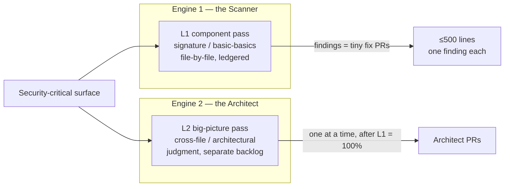

# AI Security Theory

The ledger is the root of trust for security. Everything else — the scan, the
fix, the backlog — checks against it. This is the methodology for hardening a
codebase with AI so that security is **coverage you can point at**, not a
90-file PR merged on faith.

It is the security sibling of [AI Use Theory](../ai-use-theory/README.md): where
the use-theory converges a *bug* (find the break, fix it, test green), the
security theory covers a *surface* (scan every line, fix every finding, and be
able to prove both from the ledger).

> **The one assumption:** *a surface is only as secure as its last scan.* You
> cannot claim a file is secure until the ledger says it was scanned — by which
> model, on what date, against which commit. The ledger is the root of trust for
> every security claim. The KB tells you what the system is *supposed* to
> guarantee (the invariants); the ledger tells you what has actually been
> *checked* against those guarantees, and when.

## The reframe in one paragraph

A security-hardening task has no bounded scope and no provable *done* — "there
are no more vulnerabilities" can never be shown, only *covered*. Hand that
open-ended task to an agent and you get the security-flavored doom loop: it claws
at an unbounded surface and ships a sprawl. The fix is to stop treating security
as a convergence task and start treating it as a **coverage** task. What you can
measure is coverage — what fraction of the trust surface has been scanned, and
what fraction of the findings are fixed. Coverage is ledgered and monotonic.
**Forward progress on security = the ledger fills up and the backlog drains, both
monotonically, and you can point at the ledger and show it.**

## The two engines

Security findings split into two fundamentally different kinds, run as two
separate engines so they can't contaminate each other:

**L1 first across every file, then L2.** The floor before the ceiling.

## The map

| Directory | What it covers |
|---|---|
| [the-failure/](./the-failure/README.md) | Why the old way fails — the 1157/1159 post-mortem, the giant-PR trap, what "no security" actually means for a one-dev project |
| [the-scanner/](./the-scanner/README.md) | **Engine 1** — the L1 component pass: read-only, file-by-file, parallel, freestyle granularity. Plus [the-checklist.md](./the-scanner/the-checklist.md), the actual signature list |
| [the-architect/](./the-architect/README.md) | **Engine 2** — the L2 big-picture backlog: cross-file / architectural findings, done one at a time after L1 is 100% |
| [the-ledger/](./the-ledger/README.md) | The altitude — the format, PASS + deferral, freestyle granularity. Plus [staleness-and-cadence.md](./the-ledger/staleness-and-cadence.md), the relative-staleness rule, the 3–6 month clock, and the ratchet |
| [running-it/](./running-it/README.md) | The operation — parallel workspaces, the scan→fix PR flow, and the seven enforceable rules |

## The seven rules (the enforceable summary)

1. **No security PR over 500 lines. Target ~100.** One finding = one fix PR.
2. **The scan is read-only.** It produces a ledger PR + backlog tasks, never code.
3. **L1 across every file before any L2.** The floor before the ceiling.
4. **Every scan is ledgered** — file/component, level, model, date, commit,
   subsystem, status. No scan that isn't in the ledger happened.
5. **Every fix lands a pinning test.** Coverage ratchets; it does not regress.
6. **Re-scan on a 3–6 month cadence.** Staleness is relative; the cadence is the
   clock.
7. **Parallelize the scan, not the fix.** Many read-only scanners at once; fix PRs
   land one finding at a time.

## Where the state lives

The *method* is here (portable — drop it in any repo). The *state* — the actual
ledger, the scan records, and the big-picture backlog — lives in the per-repo
knowledge base, e.g. `knowledge-base/security/`. The method tells you how; the
knowledge base records what.
