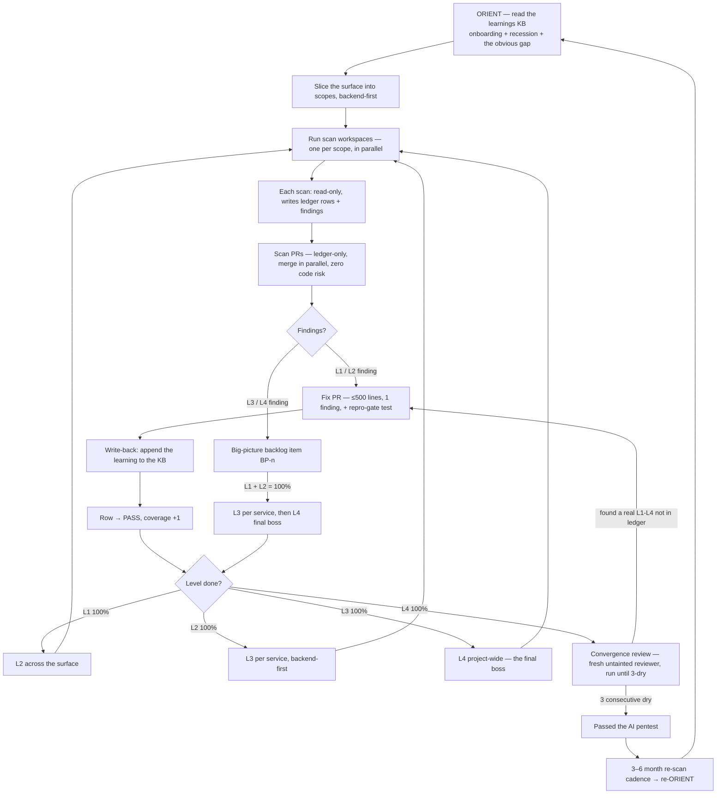
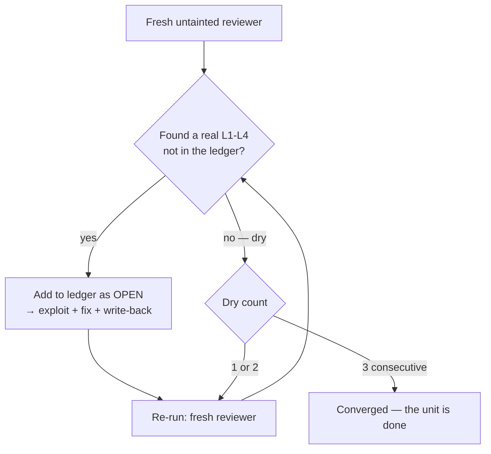

# Running It — the operation

[← back to AI Security Theory](../README.md)

The theory is only as good as the loop that runs it. This is the operational
shape: orient first, then the L1→L2→L3→L4 ladder in criticality order, how a scan
becomes a fix (with the repro gate), the write-back to the KB, and the seven rules
that keep the whole thing from decaying back into the giant-PR trap.

## The loop

## 0. Orient first (before any scan)

Do not start by scanning. Start by reading the security KB (the learnings record)
and running the three prompts — see [the-orient/](../the-orient/README.md):

1. **Onboarding** — what has been considered security-wide?
2. **Recession** — did any invariant / handled thing quietly become vulnerable
   again? (Pinning tests catch code recession; the orient catches *conceptual*
   recession.)
3. **The obvious gap** — assumption-enumerate the invariants; is there a threat
   class or a broken assumption we aren't considering?

The orient's output shapes the scan: it tells you where to look, what's already
handled (don't re-find it), and what class you might be missing. **A scan that
didn't orient is the 1157/1159 failure in miniature** — clawing at the surface
blind.

## 1. Slice the surface (parallelization, backend-first)

Do **not** point one workspace at "all the files." Slice the security-critical
surface into **scopes** — a directory, a module, a few related files — and run
**one workspace per scope**, in parallel, **in criticality order** (the API first,
then SDK, authenticator, social, marketing UI — see
[the-scope-ladder/](../the-scope-ladder/README.md) for the gradient).

- **Why parallel is safe:** a scan is read-only. It writes only the ledger +
  backlog, never code. Eight scanners across a directory cannot merge-conflict on
  application code because they touch none of it. (They can touch the *same ledger
  file* — so either serialize the ledger writes, or have each scope write its own
  ledger section and a final scan PR union-merges them. The ledger is docs; a
  union merge is trivial.)
- **Why parallel is also the anti-sycophancy move:** a workspace scanning a narrow
  scope actually reads line by line. A workspace told to "scan everything"
  skims and says "totally secure." Narrow scope = honest scan.
 - **Scope size rule of thumb:** small enough to read line by line in one session
   without skimming. If a scope is too big to actually read, split it.

## The cost (a quick win, not a program)

The security-critical core is small enough to scope by file, and the read-only scan
**parallelizes for free** — that is the whole point of the design. For web10: the
~13k-LOC security-critical core (`clickhouse.py`, `safe_query.py`, `auth.py`,
`middleware.py`, `main.py`, `settings.py`, the endpoints, the SDK) split across
**~40 parallel read-only scanners**, each doing L1+L2 on a few files and PRing
**100–200-line fixes**. That is a *batch*, not a program — a day or two of parallel
work, not months. L3 (per service) and L4 (project-wide) run the same way, after.
The convergence review adds cost on trust-boundary units (three fresh reviews), but
that's a small subset of the surface, not the whole thing. The honest total: a
moderate, *bounded* investment that amortizes over the 3–6 month cadence — not a
$100k engagement, and not free. The point is that the parallelism makes the
thorough version *cheap enough to actually run*, which is what a good-but-expensive
 process never gets.

## The fix order (within a layer) + day-1 bootstrap

**Layer by layer is already the rule** (L1 → L2 → L3 → L4, each to 100% before the
next). Within a layer, don't do pure first-in-first-out — a critical I3 break found
fifth shouldn't wait behind a low-severity hygiene item found first. The order that
makes it *easier* to implement (not harder) is two obvious sorts + one override:

1. **Severity first** — critical invariant break → high → medium → low.
2. **Tiebreak: crown jewels first** — a High in `clickhouse.py` before a High in the
   marketing UI (the criticality gradient).
3. **Override: root-cause-first** — if one fix is a *prerequisite* for another
   (removing the root cause closes the symptom), do the root cause first. This is
   the one case where you jump the severity order, and it's what actually saves
   rework.

No ranking matrix — just *severe first, backend first, root-cause-first when one
fix kills another.*

**Day-1 bootstrap:** don't derive where to start — start with the **security-critical
core at L1, backend-first**: `clickhouse.py` (the I3 read gate), `safe_query.py`
(the query-engine boundary), `auth.py` (token verify), then `middleware.py` /
`main.py` / `settings.py` and the endpoints, then the SDK (`browser.ts` / `token.ts`
/ `http.ts`). That is the crown jewels — the files where a wrong change breaks a
guarantee. Scan those L1 first (parallel scanners), fix the findings (severity
order), and *then* widen to the rest of the surface, then L2, L3, L4.

## 2. The scan → fix flow (exploit-first)

The whole flow is **led by the exploit** — the security unit test *is* a working
hack, and a finding is not real until you can demonstrate it. See
[the-ledger/](../the-ledger/README.md) (the repro gate) for the full treatment.

1. **Scan** (read-only). A workspace reads its scope against
   [the checklist](../the-scope-ladder/the-checklist.md), at the current level
   (L1, then L2, then L3, then L4). For each vuln it finds, it **builds the
   exploit** — a PoC that demonstrates the break (the hack that works) — and writes
   a ledger row (PASS / OPEN / STALE) + the finding + the PoC. It opens a **scan PR**
   that touches only the ledger + backlog (the PoC is recorded with the finding, not
   committed as a permanent test). A finding with no working exploit is a guess, not
   a finding — reject it.
2. **Merge the scan PR.** Ledger-only, zero code risk, lands in parallel with
   anything. The surface is now *known*: the ledger shows exactly what is owed, and
   every OPEN finding has a demonstrated exploit behind it.
3. **Fix, one finding at a time, exploit-first.** Each OPEN L1/L2 finding becomes a
   **fix PR**: ≤500 lines, target ~100, one finding. The PR **commits the exploit as
   the pinning test and shows red→green** — the exploit works against the vulnerable
   code (red = the vuln is real), the fix lands, the same exploit is now denied
   (green = the hole is closed). A pinning test that was green from the moment it was
   written proved nothing. The PR references the finding (and the ledger row).
4. **Write-back.** When the fix lands, **append the learning to the KB**
   ([the-orient/](../the-orient/README.md)): the finding + fix as a dated learning,
   any new assumption / threat class, and if a concern is retired, move it to
   considered-and-declined. This is what makes the next orient smarter.
5. **Close the row.** The row goes PASS when the **repro gate** is met (the exploit
   is denied) — see [the-ledger/](../the-ledger/README.md). If the finding was L3/L4
   (architectural), it was already deferred to a `BP-n` item; the row reads
   `PASS (1 finding → BP-n)` and the big-picture backlog carries the work.
6. **L1 → L2 → L3 → L4, each to 100%.** Finish L1 across the whole surface, then
   L2, then L3 per service, then L4 project-wide (the final boss). When all four
    are 100%, the surface has **passed the AI pentest** — see
    [the-pentest-gate/](../the-pentest-gate/README.md).

## 3. The convergence review (run until dry)

The ladder says "L1–L4 are 100%." The convergence review answers the harder
question: **"is it *actually* done, or did the scan just stop finding things?"** It
is the second pair of eyes, made a rule — and it is what lets you answer "but is the
AI a true oracle?" with *"no, but it was reviewed three times by a clean reviewer
and came up empty each time."*

**The loop:**

1. **A fresh, unbiased, untainted reviewer** — a clean context that has **not** seen
   the code, the fix, or the original scan. It is not anchored on what was already
   found, so it finds *different* things. (This is the anti-sycophancy move: the
   reviewer that wrote the fix can't be the one who signs it off.)
2. It reviews the unit / surface for **L1–L4 findings not already in the ledger.**
3. **Anything real it raises gets added** — to the ledger as OPEN (needs an exploit
   + fix) or to the plan / big-picture backlog. It then goes through the normal
   exploit-first flow (build the exploit, fix, repro gate, write-back).
4. **Re-run the review** (a fresh reviewer again).
5. **Stop on three consecutive dry reviews** — three in a row where the reviewer
   comes back with nothing new ("I'm out of ideas"). Before you hit three-dry, it is
   still bringing up real stuff; three-dry is the convergence signal.

**Why three, not one:** a single dry review is luck; three independent fresh
reviews all coming up empty is *evidence*. The number is a judgment (three is the
default), but the principle is **convergence detection with a margin** — you don't
call it done on the first quiet pass, you call it done when it's been quiet
repeatedly.

**What it is:** not an oracle. It is **bounded, evidenced uncertainty.** The claim
you can make is not "this is secure" — it is *"this was reviewed three times by a
clean reviewer, empty each time, and everything any review ever found is in the
ledger."* That is the honest best, and it is strong, because the uncertainty is
*bounded* (three-dry) and *evidenced* (the ledger), not a vibe.

### Model diversity (hitting the class-level blind spots)

Three fresh reviews of the *same model family* reduce **anchoring** risk (the
reviewer doesn't know what was already found) but not **capability** risk — if the
model *family* shares a blind spot (all trained on similar data, all missing a
certain vuln type), three-dry won't catch it. The fix is **model diversity**, and
the ledger's `model=` field is the hook that makes it possible:

- **Layer different model families.** Run the scan (and the convergence review)
  with *different* models, one after another — a frontier model, a different
  vendor's model, a smaller workhorse. Each family has different blind spots; the
  **union** of their findings is more complete than any one. The `model=` field on
  each ledger row records *which* model found what, so you can see the coverage per
  family.
- **Transparency makes the blind spots visible.** Because every row says which
  model produced it, you can *see* if a whole family never finds a certain class —
  and that's the signal to add a different family (or the late-stage gauntlet's
  fuzzing) for that class.
- **It's an extension, not a requirement.** The base loop works with one model
  family (three-dry, same family). Model diversity is the *upgrade* you add as the
  stakes rise (crown jewels, pre-production) — and it composes with the late-stage
  hacker gauntlet (frontier models + fuzzing) for the classes even a diverse model
  set misses.

So the convergence review's "not an oracle" limit is *narrowed* by model diversity:
you're not betting on one brain, you're betting on the union of several, and the
ledger shows you exactly which brain found what.

## The rules (enforceable)

These are the whole theory compressed to what a reviewer can check on any PR:

1. **No security PR over 500 lines. Target ~100.** One finding = one fix PR.
   *(A 90-file security PR is a review rejection.)*
2. **The scan is read-only.** A scan PR touches only the ledger + backlog. If a
   "scan" PR touches application code, it is not a scan — reject it.
3. **Orient before you scan.** A scan PR with no orient (no learnings read, no
   recession/gap check) is blind — reject it.
4. **L1 → L2 → L3 → L4, each to 100% before the next, backend-first.** No L2 until
   L1-PASS; no L3 until L2-PASS; no L4 until L3-PASS.
5. **Every fix passes the repro gate** — the exploit replayed, denied, red-then-
   green. **L1/L2: a deterministic exploit** (mocking forces the conditions — mock
   the clock for the race, the second actor, the payload). **L3/L4: deterministic
   when feasible, else a scrutinized explanation** (the exact sequence, why it's
   real, what prevents it — adversarially checked). A fix PR with no repro-gate test
   (or L3/L4 explanation) is not done.
6. **Every fix writes back to the KB** — and so does every *failed* exploit (a
   confirmed non-vulnerability is a learning, not a discarded false positive). A PR
   that doesn't append the learning breaks the orient loop — reject it.
7. **Re-scan on a 3–6 month cadence, on a stronger model.** Staleness is relative;
   the cadence is the clock; the model upgrade is the third ratchet. A surface with
   no re-scan in 6+ months is STALE by default.
8. **Trust-boundary units need the convergence review** — three consecutive dry
   passes by a fresh, untainted reviewer, **across different model families** (the
   `model=` field is the diversity hook). A PASS without three-dry is a claim, not
   a verification.
9. **The gauntlet + gate enforce it** — the accumulated exploits run in CI on every
   PR (a regression fails the build); a trust-boundary PR must pass the gate (≤500
   lines, red→green test or scrutinized explanation, ledger updated). See
   [the-gauntlet/](../the-gauntlet/README.md). The wrong way doesn't merge.

*(Parallelize the scan, not the fix, is the operating note under rules 1–2: ~40
read-only scanners at once across the core; fix PRs land one finding at a time.
That's what makes it a quick win, not a program.)*

## The gate (what "done" means)

A surface is **done** — it has **passed the AI pentest** — when:

- it was **oriented** (the learnings read, recession + gap checked, recorded),
- every unit in the scope has a row at **every level** it is in scope for (L1, L2,
  L3, L4) that is PASS or STALE-requeued (no silent gaps),
- every **OPEN** finding is a tracked item — a fix PR (L1/L2) or a big-picture
  backlog entry (L3/L4) — nothing found is unlogged,
- every **fix** passed the **repro gate** (the exploit is replayed and denied), and
- every **trust-boundary unit** passed the **convergence review** (three
  consecutive dry passes by a fresh, untainted reviewer), and
- the **big-picture backlog** is visible and ordered (the architectural debt is
  counted, not hidden).

"Done" is not "secure." It is *oriented, fully scanned, fully accounted for,
repro-verified, convergence-reviewed, and ratcheting.* That is the most a one-dev
project can honestly claim — and the ledger + learnings are the proof. See
[the-pentest-gate/](../the-pentest-gate/README.md) for the claim, stated.
