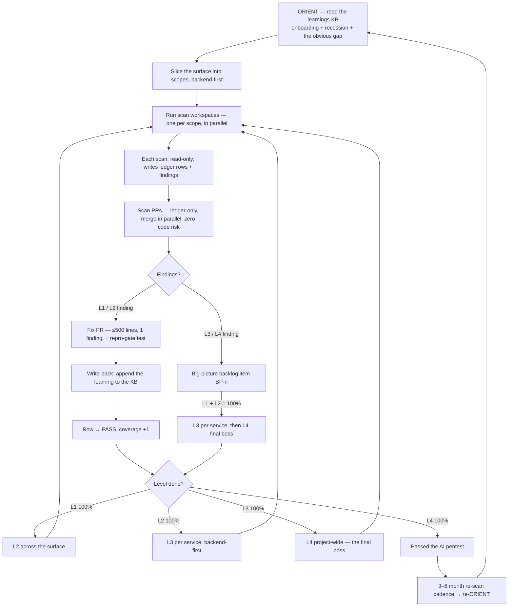

# Running It — the operation

[← back to AI Security Theory](../README.md)

The theory is only as good as the loop that runs it. This is the operational
shape: orient first, then the L1→L2→L3→L4 ladder in criticality order, how a scan
becomes a fix (with the repro gate), the write-back to the KB, and the seven rules
that keep the whole thing from decaying back into the giant-PR trap.

## The loop

## 0. Orient first (before any scan)

Do not start by scanning. Start by reading the security KB (the learnings record)
and running the three prompts — see [the-orient/](../the-orient/README.md):

1. **Onboarding** — what has been considered security-wide?
2. **Recession** — did any invariant / handled thing quietly become vulnerable
   again? (Pinning tests catch code recession; the orient catches *conceptual*
   recession.)
3. **The obvious gap** — assumption-enumerate the invariants; is there a threat
   class or a broken assumption we aren't considering?

The orient's output shapes the scan: it tells you where to look, what's already
handled (don't re-find it), and what class you might be missing. **A scan that
didn't orient is the 1157/1159 failure in miniature** — clawing at the surface
blind.

## 1. Slice the surface (parallelization, backend-first)

Do **not** point one workspace at "all the files." Slice the security-critical
surface into **scopes** — a directory, a module, a few related files — and run
**one workspace per scope**, in parallel, **in criticality order** (the API first,
then SDK, authenticator, social, marketing UI — see
[the-scope-ladder/](../the-scope-ladder/README.md) for the gradient).

- **Why parallel is safe:** a scan is read-only. It writes only the ledger +
  backlog, never code. Eight scanners across a directory cannot merge-conflict on
  application code because they touch none of it. (They can touch the *same ledger
  file* — so either serialize the ledger writes, or have each scope write its own
  ledger section and a final scan PR union-merges them. The ledger is docs; a
  union merge is trivial.)
- **Why parallel is also the anti-sycophancy move:** a workspace scanning a narrow
  scope actually reads line by line. A workspace told to "scan everything"
  skims and says "totally secure." Narrow scope = honest scan.
- **Scope size rule of thumb:** small enough to read line by line in one session
  without skimming. If a scope is too big to actually read, split it.

## 2. The scan → fix flow

1. **Scan** (read-only). A workspace reads its scope against
   [the checklist](../the-scope-ladder/the-checklist.md), at the current level
   (L1, then L2, then L3, then L4). It writes ledger rows (PASS / OPEN / STALE)
   and, for each finding, a backlog entry. It opens a **scan PR** that touches only
   the ledger + backlog.
2. **Merge the scan PR.** Ledger-only, zero code risk, lands in parallel with
   anything. The surface is now *known*: the ledger shows exactly what is owed.
3. **Fix, one finding at a time.** Each OPEN L1/L2 finding becomes a **fix PR**:
   ≤500 lines, target ~100, one finding, and a **repro-gate test** — the exploit
   that worked, replayed, now denied (red first, green second). The PR references
   the finding (and the ledger row).
4. **Write-back.** When the fix lands, **append the learning to the KB**
   ([the-orient/](../the-orient/README.md)): the finding + fix as a dated learning,
   any new assumption / threat class, and if a concern is retired, move it to
   considered-and-declined. This is what makes the next orient smarter.
5. **Close the row.** The row goes PASS when the **repro gate** is met (see
   [the-ledger/](../the-ledger/README.md)). If the finding was L3/L4
   (architectural), it was already deferred to a `BP-n` item; the row reads
   `PASS (1 finding → BP-n)` and the big-picture backlog carries the work.
6. **L1 → L2 → L3 → L4, each to 100%.** Finish L1 across the whole surface, then
   L2, then L3 per service, then L4 project-wide (the final boss). When all four
   are 100%, the surface has **passed the AI pentest** — see
   [the-pentest-gate/](../the-pentest-gate/README.md).

## The seven rules (enforceable)

These are the whole theory compressed to what a reviewer can check on any PR:

1. **No security PR over 500 lines. Target ~100.** One finding = one fix PR.
   *(A 90-file security PR is a review rejection.)*
2. **The scan is read-only.** A scan PR touches only the ledger + backlog. If a
   "scan" PR touches application code, it is not a scan — reject it.
3. **Orient before you scan.** A scan PR with no orient (no learnings read, no
   recession/gap check) is blind — reject it.
4. **L1 → L2 → L3 → L4, each to 100% before the next, backend-first.** No L2 until
   L1-PASS; no L3 until L2-PASS; no L4 until L3-PASS.
5. **Every fix passes the repro gate** — the exploit replayed, denied, red-then-
   green. A fix PR with no repro-gate test is not done.
6. **Every fix writes back to the KB.** A fix PR that doesn't append the learning
   to the learnings record breaks the orient loop — reject it.
7. **Re-scan on a 3–6 month cadence.** Staleness is relative; the cadence is the
   clock. A surface with no re-scan in 6+ months is STALE by default.

*(Parallelize the scan, not the fix, is the operating note under rules 1–2: many
read-only scanners at once; fix PRs land one finding at a time.)*

## The gate (what "done" means)

A surface is **done** — it has **passed the AI pentest** — when:

- it was **oriented** (the learnings read, recession + gap checked, recorded),
- every unit in the scope has a row at **every level** it is in scope for (L1, L2,
  L3, L4) that is PASS or STALE-requeued (no silent gaps),
- every **OPEN** finding is a tracked item — a fix PR (L1/L2) or a big-picture
  backlog entry (L3/L4) — nothing found is unlogged,
- every **fix** passed the **repro gate** (the exploit is replayed and denied), and
- the **big-picture backlog** is visible and ordered (the architectural debt is
  counted, not hidden).

"Done" is not "secure." It is *oriented, fully scanned, fully accounted for,
repro-verified, and ratcheting.* That is the most a one-dev project can honestly
claim — and the ledger + learnings are the proof. See
[the-pentest-gate/](../the-pentest-gate/README.md) for the claim, stated.
