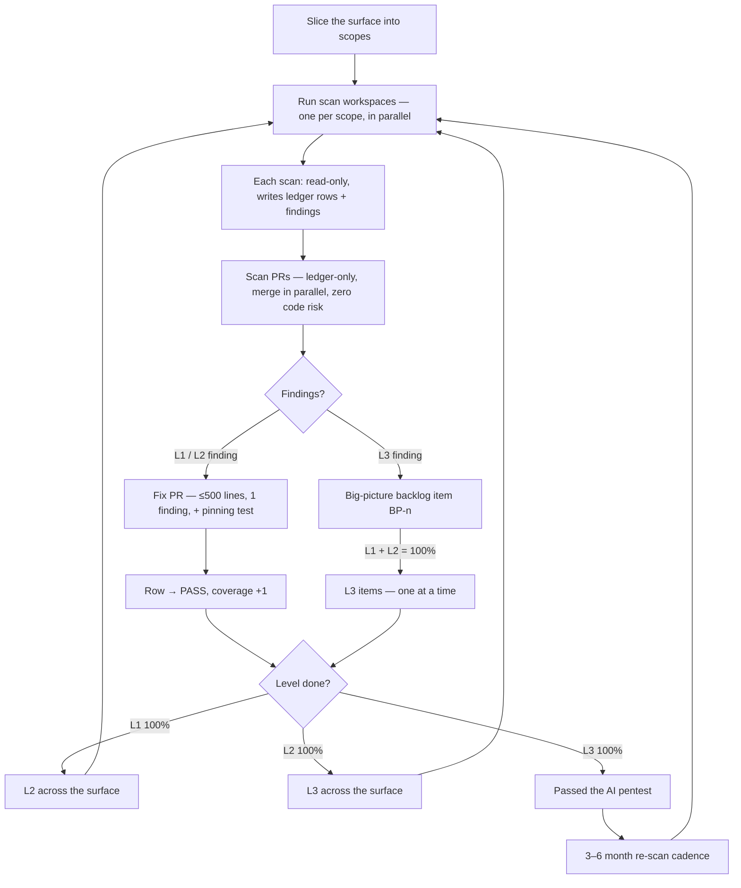

# Running It — the operation

[← back to AI Security Theory](../README.md)

The theory is only as good as the loop that runs it. This is the operational
shape: how workspaces are sliced, how a scan becomes a fix, the L1→L2→L3 order,
and the seven rules that keep the whole thing from decaying back into the
giant-PR trap.

## The loop

## Slicing the surface (parallelization)

Do **not** point one workspace at "all the files." Slice the security-critical
surface into **scopes** — a directory, a module, a few related files — and run
**one workspace per scope**, in parallel.

- **Why parallel is safe:** a scan is read-only. It writes only the ledger +
  backlog, never code. Eight scanners across a directory cannot merge-conflict on
  application code because they touch none of it. (They can touch the *same ledger
  file* — so either serialize the ledger writes, or have each scope write its own
  ledger section and a final scan PR union-merges them. The ledger is docs; a
  union merge is trivial.)
- **Why parallel is also the anti-sycophancy move:** a workspace scanning a narrow
  scope actually reads line by line. A workspace told to "scan everything"
  skims and says "totally secure." Narrow scope = honest scan.
- **Scope size rule of thumb:** small enough to read line by line in one session
  without skimming. If a scope is too big to actually read, split it.

The security-critical core is small enough to scope by file. For web10 the October
audit sized it at ~5–6k LOC (`clickhouse.py`, `safe_query.py`, `auth.py`,
`middleware.py`, `main.py`, `settings.py`, the endpoints that call them, and the
SDK's `browser.ts` / `token.ts` / `http.ts`). That is a handful of scopes, not a
firehose.

## The scan → fix flow

1. **Scan** (read-only). A workspace reads its scope line by line against
   [the checklist](../the-scope-ladder/the-checklist.md), at the current level
   (L1, then L2, then L3). It writes ledger rows (PASS / OPEN / STALE) and, for
   each finding, a backlog entry. It opens a **scan PR** that touches only the
   ledger + backlog.
2. **Merge the scan PR.** Ledger-only, zero code risk, lands in parallel with
   anything. The surface is now *known*: the ledger shows exactly what is owed.
3. **Fix, one finding at a time.** Each OPEN L1/L2 finding becomes a **fix PR**:
   ≤500 lines, target ~100, one finding, and a **pinning test** that fails if it
   regresses. The PR references the finding (and the ledger row).
4. **Close the row.** When the fix lands, the row goes PASS. If the finding was
   architectural (L3), it was already deferred to a `BP-n` item; the row reads
   `PASS (1 finding → BP-n)` and the big-picture backlog carries the work.
5. **L1 → L2 → L3, each to 100%.** Finish L1 across the whole surface, then L2,
   then L3. Only when L1 + L2 are 100% do the L3 `BP-n` items start, one at a
   time, each as its own bounded PR(s). When all three are 100%, the surface has
   **passed the AI pentest** — see [the-pentest-gate/](../the-pentest-gate/README.md).

## The seven rules (enforceable)

These are the whole theory compressed to what a reviewer can check on any PR:

1. **No security PR over 500 lines. Target ~100.** One finding = one fix PR.
   *(A 90-file security PR is a review rejection.)*
2. **The scan is read-only.** A scan PR touches only the ledger + backlog. If a
   "scan" PR touches application code, it is not a scan — reject it.
3. **L1 → L2 → L3, each to 100% before the next.** No L2 until the surface is
   L1-PASS; no L3 until it is L2-PASS.
4. **Every scan is ledgered.** A security claim with no ledger row behind it did
   not happen. No row, no PASS.
5. **Every fix lands a pinning test.** A fix PR with no regression test is not
   done — the coverage would silently regress.
6. **Re-scan on a 3–6 month cadence.** Staleness is relative; the cadence is the
   clock. A surface with no re-scan in 6+ months is STALE by default.
7. **Parallelize the scan, not the fix.** Many read-only scanners at once; fix PRs
   land one finding at a time.

## The gate (what "done" means)

A surface is **done** — it has **passed the AI pentest** — when:

- every unit in the scope has a row at **every level** it is in scope for (L1, L2,
  L3) that is PASS or STALE-requeued (no silent gaps),
- every **OPEN** finding is a tracked item — a fix PR (L1/L2) or a big-picture
  backlog entry (L3) — nothing found is unlogged,
- every **fix** has a pinning test, and
- the **big-picture backlog** is visible and ordered (the architectural debt is
  counted, not hidden).

"Done" is not "secure." It is *fully scanned, fully accounted for, and ratcheting.*
That is the most a one-dev project can honestly claim — and the ledger is the
proof. See [the-pentest-gate/](../the-pentest-gate/README.md) for the claim,
stated.
