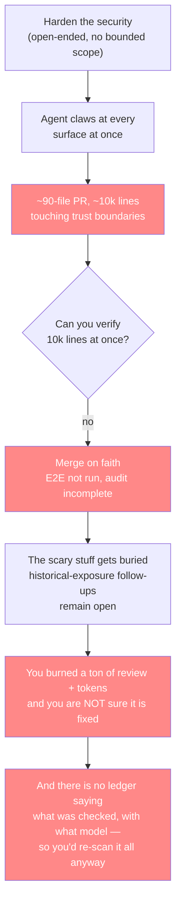

# The Security Post-Mortem — how the first pass went wrong

[← back to AI Security Theory](../README.md)

This is the story the whole theory exists to prevent. It is told the way
[ai-use-theory opens on the money-bleed](../../ai-use-theory/ai-use-theory.md) —
concrete, with the cost on the table — because the theory only has teeth if you
feel what the old way cost.

## What happened (PRs 1157 + 1159)

Two security-hardening PRs, opened the same week, ~90 files each, ~10k lines of
security code between them:

- **#1157** — "Harden API security and add scoped app management delegation."
  Verified self/app credentials, RS256/JWKS, signed-origin revocable delegation,
  hardened query/document/media/HLS/import/recovery boundaries, removed secret
  defaults + sensitive logging. Touched `api/`, `sdk/`, `ui/`, the social app, and
  a dozen KB docs.
- **#1159** — "Harden SDK credential boundaries, RTC admission, and group-detail
  transport." Popup sender validation, credential redirects, cookie/JWT handling,
  one-use RTC tickets, credential-log redaction. Touched `api/`, `api/rtc/`,
  `sdk/`, the social app, CI, and deployment.

Both were still **open** when this theory was written. Both carried the same tells
in their own descriptions:

> #1157: *"…the opt-in live probe, live delegation gauntlet, deployment review, and
> independent audit **remain incomplete**."*
>
> #1159: *"**Coordinate overlapping API/KB changes with #1157 before merging** and
> deploy API/RTC/SDK/consumers together, with documented expiry, sender,
> diagnostic, issuer, and **historical-exposure follow-ups remaining open**."*

## The money-bleed (why a giant security PR is the doom loop)

A feature PR that is wrong breaks a feature — you see it, you revert it, done. A
security PR that is wrong breaks a *guarantee*, and you don't see it until someone
exploits it. So the review bar is higher, the blast radius is bigger, and the
"it's probably fine" that gets a 90-file feature PR merged is exactly the attitude
that gets a 90-file *security* PR merged on faith.

Each red box is money and trust burned. The PR is big enough that you cannot
review it line by line, so you review it by *vibe* — and a vibe is not a security
control.

## The scratch-your-head ending

Here is the part that should leave you uneasy. After 1157/1159 land, you cannot
answer the question that actually matters: **"do I know what was checked?"**

- You burned a ton — two 90-file PRs, a breaking 4.0.0 rollout, a coordinated
  multi-service deploy.
- You are **not sure it's fixed** — "the independent audit remains incomplete,"
  "full browser E2E was not run," "historical-exposure follow-ups remaining open."
- And even if it is fixed *today*, **you have to scan it all over again anyway** —
  because there is no ledger confirming *what was checked, with what model, on
  what date, against what commit.*

That last point is the whole theory in one sentence. **Security without a ledger
is not a checkbox you can tick — it is a vibe you have to re-earn every time.**
"Looked at, considered" is not a claim you can make from a merged PR. It is a
claim you can make from a *row in a ledger.* The theory exists to turn security
from the former into the latter.

## The merge-breakage closer (why bite-sized is not optional)

Now merge 1157 and 1159. What happens:

1. **A ton of unit tests go red** — 10k lines of security code changed at once
   touched half the trust boundaries, and the existing suite was written against
   the *old* behavior.
2. **There are surely breaks *outside* the old tests** — the suite only covers what
   someone thought to test. 10k lines of change means 10k lines of *possibly*
   changed behavior, and the untested 90% is where the real breaks live.
3. **Debugging "which of the 10k lines broke which feature" is a nightmare** — the
   blast radius is the whole PR. You cannot bisect a 90-file security PR the way
   you bisect a feature; every file is entangled with every other through the
   shared trust boundaries.

A bite-sized PR inverts all three. A ~100-line fix PR touches one trust boundary,
so the tests that go red are *the ones for that boundary* — you know what broke and
why. The untested surface is small, not 90%. And if it's wrong, you throw away 100
lines, not 10k. **The total work is the same; the debuggability per unit is what
changes — and that is the thing that was broken.**

## The answer (what the theory does about each of these)

| The failure | The answer |
|---|---|
| Open-ended scope → a sprawl | The **scope ladder** — L1 file → L2 call-graph → L3 service → L4 project-wide, each a bounded pass ([the-scope-ladder/](../the-scope-ladder/README.md)) |
| No provable done → merge on faith | **The ledger** — a row per (unit, level) is the done ([the-ledger/](../the-ledger/README.md)) |
| 90-file PR → unreviewable, un-bisectable | **Bite-sized fix PRs** — ≤500 lines, one finding, a repro-gate test ([running-it/](../running-it/README.md)) |
| "Do I know what was checked?" → no | **The ledger is the root of trust** — model, date, commit, status, per unit |
| The scary stuff buried | **L3 + the big-picture backlog** — counted and ordered, not hidden |
| One-off, then it rots | **The 3–6 month re-scan cadence** — it ratchets, it doesn't rot ([the-ledger/staleness-and-cadence.md](../the-ledger/staleness-and-cadence.md)) |
| "Is it actually secure?" → a vibe | **The AI pentest gate** — L1+L2+L3 all passed = a claim the ledger backs ([the-pentest-gate/](../the-pentest-gate/README.md)) |
