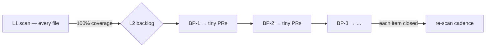

# The Architect — Engine 2, the L2 big-picture backlog

[← back to AI Security Theory](../README.md)

The Architect handles the findings the Scanner cannot: the **cross-file,
design-level** ones. These are not signatures you match line-by-line — they are
*judgments* about how the system is put together. The federation key model, the
delegation design, a breaking credential rollout, "these two services must deploy
together or the guarantee is broken."

## Why it is a separate engine

Folding architectural findings into the line-by-line scan is exactly how you get
back to the giant-PR trap. An architectural fix is unbounded — it touches several
files, changes a design, and may force a breaking rollout. If it is mixed into the
scan, the scan stops being bounded and parallel, and the "one finding = one tiny
PR" rule dies. So L2 lives in its **own backlog**, is **visible at all times**,
and is done **one item at a time.**

The failure this prevents: in 1157/1159 the architectural risks (the federation
key model, the coordinated rollout) got **buried under the sprawl** and surfaced
only as "historical-exposure follow-ups remaining open." A separate backlog means
they are *tracked and counted*, not hidden.

## When a finding is L2, not L1

A finding goes to the Architect when any of these is true:

- It **spans more than one file** and the fix is a *design* change, not a local
  edit.
- It changes a **trust boundary or a protocol** (the token model, the federation
  signing, the contract shape).
- It requires a **breaking change or a coordinated multi-service deploy.**
- It is a **residual / historical exposure** — something that was true in the past
  and needs a deliberate decision (rotate, re-login, disclose), not a code edit.
- Fixing it **correctly** depends on a decision only a human can make (risk
  acceptance, rollout timing, disclosure).

If a Scanner workspace hits one of these, it does **not** try to fix it. It writes
the finding to the big-picture backlog with a reference, marks the ledger row
accordingly, and moves on. The scan stays focused; the backlog captures the debt.

## The backlog

The big-picture backlog is a **numbered, logged list** in the per-repo knowledge
base (e.g. `knowledge-base/security/big-picture-backlog.md`). Each item:

```
BP-14  [open]  Federation: HS256 → RS256/EdDSA + JWKS (D7)
  found-by   scan 2026-10, clickhouse.py + auth.py, model=qwen3.6-27b
  invariant  I1
  why-L2     cross-file protocol change; breaking; coordinated deploy
  plan       dual-verify during migration, then drop HS256
  status     open  (blocks: —)  (unblocks: BP-15)
```

Rules for the backlog:

- **Numbered and stable** — `BP-n` references survive reordering, so ledger rows
  and fix PRs can point at an item.
- **Every item has a `why-L2`** — the one-line reason it is architectural, not a
  scan finding. This is the gate that keeps L1 and L2 from bleeding together.
- **Ordered by dependency, then severity** — an item that blocks others goes
  first; a critical invariant break beats a hardening nicety.
- **One item = one (bounded) PR** — even an architectural fix is broken into
  ≤500-line PRs where possible. The *decision* is one item; the *implementation*
  is a sequence of small PRs that all reference it.

## The ordering rule: L1 to 100%, then L2

The Architect does not start until the Scanner has reached **100% L1 coverage** of
the surface. The reason is not pedantry — it is that L1 is the bounded floor that
makes the system *known*. You do not redesign the federation model on top of a
surface you have not finished scanning; you finish the scan, you know every
signature-level hole, and *then* you take the architectural items one at a time,
each on a clean, fully-scanned base.



## L2 staleness is different from L1

An L1 row goes stale on relative time (a commit or ~3 months). An **L2 item goes
stale on an architectural change** — a decision lands, a boundary moves, the
threat model shifts — *not* on a single file's commit. Tying L2 freshness to a
file commit would re-run frontier judgment constantly for nothing. See
[staleness-and-cadence.md](../the-ledger/staleness-and-cadence.md).
