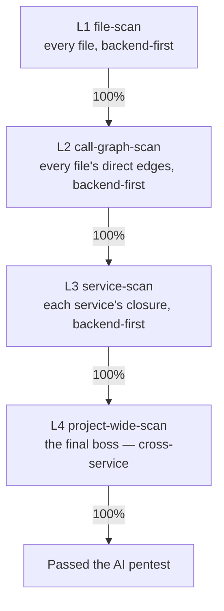

# The Scope Ladder — L1 → L2 → L3 → L4

[← back to AI Security Theory](../README.md)

Security scanning is **one activity at four zooms** — not two engines, not a
vibe. You run the same line-by-line, ledgered scan at each level, **one level at a
time, each to 100% before the next.** The ladder is what makes "harden the
security" a bounded, orderable task instead of an open-ended sprawl.

## The four levels

| Level | Scope | The question it asks | Catches |
|---|---|---|---|
| **L1 file-scan** | the file itself, line by line | "is *this line / this function* a vulnerability in isolation?" | the basic basics — secret in source, unsigned decode, missing origin check, no auth gate, token in a log, injection, unsanitized render |
| **L2 call-graph-scan** | the file + its **direct** call graph (one hop) | "is this file's *immediate interface* safe?" | the edge vuln — source and sink **one hop apart**, no check between (token→log, unvalidated input→dangerous callee) |
| **L3 service-scan** | the whole service / library / module (the API, the SDK, the authenticator, …) | "is this file safe *anywhere in its service* it can be reached from / flow to?" | the transitive vuln — source and sink **several hops apart**, the missing check in the middle of the chain; the intra-service pattern |
| **L4 project-wide-scan** | the whole project (all services together) | "is the *system* safe — the boundaries *between* services?" | the final boss — the cross-service architecture: the federation model, the coordinated deploy, "these services must move together or the guarantee is broken" |

## The L2/L3 boundary: hop count (the thing that keeps the rungs from collapsing)

L2 and L3 are both "the file + its relationships," so without a hard line they
collapse into the same pass. The line is **mechanical**: **how many hops between
source and sink?**

- **L2 = the file + its *direct* edges only — one hop.** The functions it directly
  calls, and the functions that directly call *it*. Not their callers, not their
  callees. You can see the direct edges by reading the file + its imports + a
  `grep` for its name. Bounded, fast, parallel.
- **L3 = the *transitive* closure — follow the edges until you run out.** That is
  "everything in the service that calls it," and it is deliberately where that
  lives. You're tracing untrusted data through the whole service to find a
  source→sink path that bypasses every check. Expensive, judgment-heavy, needs the
  whole service in view.

> **The test:** count the hops from the untrusted source to the dangerous sink.
> **One hop** → L2. **More than one hop** → L3. The count is mechanical, so two
> agents won't disagree about which level a finding belongs on.

This is what keeps L2 *actually* narrower than L3: L2 is the cheap, parallel,
"read the file + grep its direct callers/callees" pass; L3 is the "trace the taint
through the whole service" pass. A finding where the dangerous callee is a direct
call is L2; a finding where the data travels through three functions before hitting
the sink is L3.

## The zoom is the only thing that changes

The *method* is identical at every level: read the unit, check it against
[the checklist](./the-checklist.md), write a ledger row, log any finding. L1 is
the Norton pass on one file. L2 is the Norton pass with the direct call graph open.
L3 is the taint trace across a service. L4 is the taint trace across the whole
project. Same discipline, four zooms.

## The criticality gradient (the order within the ladder)

A project has **multiple things to secure** — for web10: the **API** (backend),
the **SDK**, the **authenticator**, the **social app**, the **marketing UI**, the
**RTC** service. They are **not equal**. The gradient runs **backend → frontend**,
and the reason is precise, not vibes:

> **A backend vuln's exploit chain has no human in it.** A bot can hit the API
> directly, 24/7, with no victim doing anything. **If the backend leaks, we're
> fucked** — the data is gone, full stop.
>
> **A frontend vuln's exploit chain *includes the victim doing something*** —
> clicking a link, leaving a session open, being on someone else's machine, being
> phished. It *requires human negligence* to land. That's why it's lower on the
> gradient: the attack surface is real, but the blast radius is gated on a human
> mistake.

So the ladder is run **backend-first**: the crown jewels (the API, the trust root)
get the deepest, earliest coverage. The gradient is a property of the *services*,
so it lives in the per-repo state (web10's order: API > SDK > authenticator >
social > marketing UI, + RTC); the *principle* is portable — **trust-root first,
human-in-the-loop surfaces last, ranked by how much human negligence an exploit
requires.**

## The order: nested by criticality, then by zoom

You do **not** flat-sweep "L1 everything → L2 everything → L3 everything → L4
everything." You nest:

1. **L1 + L2 on everything, backend-first.** Every file (L1), then every file's
   direct call graph (L2), across all services in criticality order (API → SDK →
   authenticator → social → marketing UI). These are the bounded, parallel,
   ledgered floor.
2. **L3 per service.** Each service's transitive closure, in criticality order.
   The floor is now clean, so an L3 finding is genuinely a multi-hop / pattern
   vuln, not a missed line.
3. **L4 project-wide — the final boss.** Last, because it's the widest and the most
   judgment-heavy. This is where you count out the "stupid stupid shit we could be
   doing really wrong" — the systemic, cross-service mistakes no single-service
   scan can see.

Each level is the **floor** for the next: you don't trace taint through a service
(L3) you haven't finished reading line by line (L1/L2), and you don't reason about
the system (L4) on top of services you haven't traced (L3).

## Where a finding goes

- **L1 / L2 finding** → a ledger row (OPEN) + a **fix PR** (≤500 lines, one
  finding, a **repro-gate** test). The scan logs the debt; the fix pays it down.
- **L3 / L4 finding** → the **big-picture backlog** (`BP-n`), because it is
  cross-file / architectural and may force a breaking or coordinated change. Done
  one at a time, as bounded PRs that reference the item. (L3/L4 findings are still
  *found by the scan* — the backlog is just where that kind of debt is tracked.)
