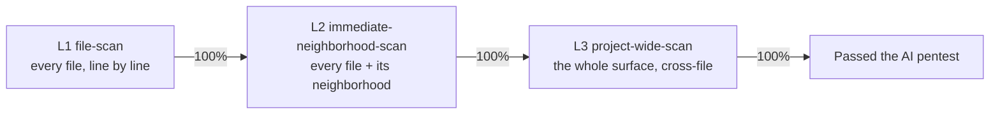

# The Scope Ladder — L1 → L2 → L3

[← back to AI Security Theory](../README.md)

Security scanning is **one activity at three zooms** — not two different engines.
You run the same line-by-line, ledgered scan at each level, **one at a time**, each
to 100% before the next. The ladder is what makes "harden the security" a bounded,
orderable task instead of an open-ended sprawl.

## The three levels

| Level | Scope | What the scanner looks at | Catches |
|---|---|---|---|
| **L1 file-scan** | the file itself | every line of the file, against the checklist | the basic basics — secret in source, unsigned decode, missing origin check, no auth gate, token in a log, injection, unsanitized render |
| **L2 immediate-neighborhood-scan** | the file + what it touches | the file's callees, its module, the boundary it sits on, the data that flows in/out | "the bug lives in the helper" — the finding that only makes sense with the neighbor in view (a function that's fine alone but unsafe given what it calls) |
| **L3 project-wide-scan** | the whole surface, cross-file | the architecture: trust boundaries, the token model, the federation signing, deploy coupling | the architectural — the federation key model, the coordinated rollout, "these services must deploy together or the guarantee is broken" |

The zoom is the only thing that changes. The *method* is the same at every level:
read the unit line by line, check it against [the checklist](./the-checklist.md),
write a ledger row, log any finding. L1 is the Norton pass; L2 is the Norton pass
with the neighboring files open; L3 is the Norton pass over the whole map.

## Why a ladder, not two engines

The old framing split security into "the Scanner" (signatures) and "the
Architect" (judgment) — two engines, two backlogs, a scan-then-architect
sequence. That was corny and it was also wrong: the architectural findings are not
a different *kind* of work, they are the *same* work at a wider zoom. A
federation-key-model finding is found by reading the same lines, just with the
whole surface in view instead of one file. So there is one activity, three zooms,
and the ladder replaces the two-engine split.

## The order: L1 → L2 → L3, each to 100%

You do **not** interleave the levels. You finish L1 across the whole surface, then
L2 across the whole surface, then L3. The reason is the same as the old "L1 before
L2" rule, now generalized: **each level is the floor for the next.**

- **L1 first** — it is the bounded, parallel, ledgered floor. It makes the surface
  *known* at the line level. You don't reason about the architecture on top of a
  surface you haven't finished reading line by line.
- **L2 second** — now that every file is L1-clean, the neighborhood scan has a
  clean base to reason about. A L2 finding is "this file + its neighbor, together,
  are unsafe" — and you only trust that judgment when both sides are already L1-PASS.
- **L3 last** — the project-wide scan is the widest net and the most judgment-heavy.
  It runs on a surface that is already L1- and L2-clean, so an L3 finding is
  genuinely architectural, not a missed line.

## Read-only, parallel, incremental (at every level)

The properties that made the old scanner safe apply to the whole ladder:

- **Read-only.** A scan touches no code. Its only output is a ledger PR + backlog
  tasks. Safe to run many at once — see [running-it/](../running-it/README.md).
- **Parallel + incremental.** You slice the surface into scopes (a directory, a few
  files) and run a workspace per scope. You do **not** scan "all the files in one
  go" — that is how a model looks at 4,000 lines and says "totally secure." A
  scope already in the ledger only re-scans when it is relatively stale.
- **Freestyle granularity.** The scanner records at whatever level gives the right
  context — a line, a function, a file. Its call. If a bad line needs its whole
  function to explain, it records the function.

## Where a finding goes

- **L1 / L2 finding** → a ledger row (OPEN) + a **fix PR** (≤500 lines, one
  finding, a pinning test). The scan logs the debt; the fix pays it down.
- **L3 finding** → the **big-picture backlog** (`BP-n`), because it is
  cross-file / architectural and may force a breaking or coordinated change. It is
  done one at a time, as bounded PRs that reference the item. (L3 findings are
  still *found by the scan* — the backlog is just where that kind of debt is
  tracked, not a separate engine.)
