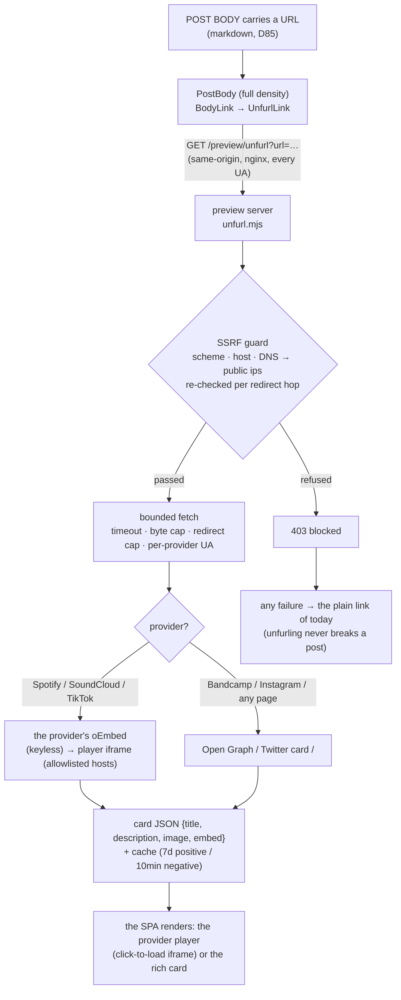

# Link Unfurling — a pasted link is a card, not a bare URL

`share-preview.md` decides what happens when a web10 link **leaves** the app
(crawler → OG card). This doc decides the other direction: what happens when a
link **enters** a post body. A link pasted into a post (the link-curation
groups — New Music, Reading Links, Shorts) unfurls into a rich attachment:
the provider's embedded player, or a preview card (title, description, image,
domain) — not an underlined text link.

## The use case

A curator drops `https://open.spotify.com/track/…` into the New Music group.
Today it renders as bare underlined text — the group looks broken next to the
YouTube links that do unfurl (the only provider the client knows). The fix is
the standard social behavior: every pasted link that can be resolved gets a
card or a player; the one that can't stays a clickable plain link, exactly as
before. Unfurling is **read-side only** — it never touches posting.

## The rule

> **The social app's preview server fetches the link; the SPA renders the
> card.** The SPA cannot fetch an arbitrary page's Open Graph tags (CORS),
> so the fetch is server-side — in the SOCIAL APP'S OWN preview server
> (`marketing/web10-social/preview/unfurl.mjs`), the same process that
> renders the crawler share cards. D60: the node stays 100% generic — it
> never learns "Spotify", "article preview", or any provider. The card is
> the social app's tail, exactly like the share card (`card.mjs`).

**The fallback is the floor.** A link that cannot be unfurled — bot-walled
(Amazon), dead, private, truncated, blocked by the SSRF guard, rate-limited —
posts and renders as a clickable plain link, exactly as before this change.
An unfurl failure is never a rendering failure.

## The endpoint

`GET /preview/unfurl?url=<encoded>` on the social app's origin. nginx proxies
it to the preview server for **every** user-agent (it is the SPA's own
same-origin JSON endpoint, not a crawler surface — the one non-crawler route
in the social nginx; `location = /preview/unfurl`). Response envelope:

| Outcome | Status | Body |
|---|---|---|
| Card found (network or cache) | 200 | `{ ok: true, card: {url, domain, provider, title, description, image, embed: {src, height, width, allow} \| null} }` |
| Not an http(s) url | 400 | `{ ok: false, reason: 'invalid_url' \| 'missing_url' }` |
| The SSRF guard refused it | 403 | `{ ok: false, reason: 'blocked' }` |
| Fetch failed / no metadata / rate-limited (5xx) | 200 / 429 | `{ ok: false, reason: 'unavailable' \| 'no_metadata' \| 'rate_limited' }` |

The SPA's client (`src/lib/unfurl.ts`) treats anything but `200 + ok:true` as
"plain link", single-flights concurrent mounts, pins only successes in the
session cache (failures retry on the next mount — the server's own TTLs do
the real caching), and re-checks the embed iframe's host against its own
per-provider allowlist (the two-sided embed gate — the server allowlists in
`unfurl.mjs`, the client in `unfurl.ts`; a card whose `embed.src` points
anywhere else renders as a rich card, never an iframe).

## The SSRF guard (the load-bearing part)

The endpoint fetches an **attacker-influenced** URL. The guard, in order:

1. **Scheme + shape**: http(s) only; no credentials in the url; no
   single-label hostnames (the docker service names — `api`, `clickhouse` —
   and mDNS records are single-label and reserved); `localhost` / `*.local` /
   `*.internal` refused by name.
2. **Address**: an IP literal is judged in place; a name is resolved
   (`dns.lookup all+verbatim`) and **every** resolved address must be public —
   loopback, RFC1918, CGNAT (100.64/10), link-local (169.254/16, the cloud
   metadata range), TEST-NET, benchmarking, multicast, reserved, and the
   IPv6 twins (`::1`, `fe80::/10`, `fc00::/7`, `ff00::/8`, `2001:db8::/32`,
   `64:ff9b::/96`, the IPv4-mapped/compatible forms judged by their embedded
   address) are all refused. A host answering with even one private address
   is ambiguous → refused.
3. **Redirects**: fetched with `redirect: 'manual'`, ≤ 5 hops, and **each hop
   re-runs the full guard** (the redirect-to-127.0.0.1 escape is the classic
   SSRF; a Location header is attacker data).
4. **Bounded**: 8s timeout per page hop (6s oEmbed), 750KB body cap (the cap
   hands back what it read — the preview tags live in the `<head>`, the first
   bytes — so a truncated 800KB shell still unfurls), one fetch per unique
   URL (the cache: 7-day positive, 10-minute negative; blocked verdicts are
   stable and cached long).
5. **Abuse dampening**: 60 requests/min per client IP (the rightmost
   X-Forwarded-For entry, the one nginx appended) → 429. A soft damper, not
   the boundary — the guard above is the boundary.

**The residual (documented, not hidden):** the guard resolves-then-fetches, so
a DNS-rebinding window exists between the check and the connection (a host
that answers public at check time and private at connect time). The mitigations
are the short negative TTL, the per-hop re-check, and the fact that the
preview server is the web edge of the social container — not the node: a
rebind that slipped through can read a public address from *inside* the box,
never user data (the preview server holds no credentials and reads only
anon-public docs). See the scan record:
`security/scans/2026-11/link-unfurl-ssrf.md`.

## The provider matrix (verified live, 07.11.2026)

| Provider | Mechanism | The card | Verified |
|---|---|---|---|
| YouTube / Vimeo | client-side `parseEmbed` (unchanged — no round-trip) | the playable player of today | pre-existing (the control) |
| Spotify | `open.spotify.com/oembed` (keyless) | the **player** (152px iframe, click-to-load) + the cover art + title | ✓ live (the task URL) |
| SoundCloud | `soundcloud.com/oembed` (keyless; `api.` subdomain is 401) | the **player** (≤320px) + title + author + artwork | ✓ live |
| TikTok | `tiktok.com/oembed` (keyless; player-only answer) | the **player** (325×578 portrait, capped + centered; `autoplay`/`muted` stripped so it click-loads like the YouTube Shorts pattern) | ✓ live (oEmbed) |
| Instagram Reels | the page fetch with the **crawler UA** (a browser UA gets the login wall; the bot shell carries `og:image` + the meta description) | the **rich card** (the reel's thumbnail + "Name … on Instagram: caption" + likes/comments description) | ✓ live |
| Bandcamp | the page fetch (a browser UA — the crawler UA gets the edge's "Client Challenge" wall, verified; the wall is refused as `no_metadata`, never a "Client Challenge" card) | the **player** when `twitter:card=player` + `twitter:player` (the EmbeddedPlayer iframe), else the **rich card** (the cover + "Album, by Artist") | mechanism ✓ (unit-pinned); the live edge challenged this fetcher's TLS fingerprint → plain link from this host |
| any other page (articles, Substack, …) | the page fetch with the browser UA → `og:` → `twitter:` → `<title>` / meta description / first `
` / first-prose fallback (legacy no-`
` HTML: the title echo + date stamp drop, whole sentences to ~200 chars) + `og:image` → `twitter:image` → first real `` (gifs / 1×1 / pixel patterns skipped, relatives resolved) | the **rich card** (16:9 image banner when there is one, favicon + domain row, title, 2-line description) | ✓ live (paulgraham.com — the task URL — and stratechery.com) |

The page fetch wears a **browser UA by default** (several edges — Bandcamp's —
actively challenge link-preview bots while serving real browsers the full
page); the crawler UA is a per-provider override (`CRAWLER_UA_OVERRIDES`,
Instagram today). A bot-challenge wall ("Client Challenge", "Just a moment…",
the `_fs-ch-` asset path) is refused as `no_metadata` — the plain link is the
honest card, never a wall-shaped card.

## The card, in the body

The read side is `PostBody`'s `BodyLink` (D85's one locked renderer): an
embeddable local provider (YouTube/Vimeo) renders its player **unchanged**;
an external http(s) link at **full density** renders `UnfurlLink` (`LinkEmbed.tsx`):

- **loading / failed** → the plain link of today (`PlainExternalLink` — one
  source for the fallback so it can't drift);
- **`card.embed`** → `PlayerEmbed` — click-to-load (the YouTube placeholder
  pattern: the poster or the music bar with the play button first, the
  allowlisted provider iframe on tap); portrait players (TikTok) cap at the
  provider's width and center;
- **else** → `RichLinkCard` — the whole card is the link (`target="_blank"`):
  optional 16:9 image, the favicon + domain row, the title (2-line clamp),
  the description (2-line clamp).

**Light / inline densities never unfurl** (repost quotes, the profile
captions, the ad copy — a block card in a `line-clamp` teaser would blow the
teaser up; they keep the plain link, as do DMs' `TextWithLinks` chips).
The unfurl is a content-driven pop-in (the card replaces the URL line when it
arrives — the Facebook model); with the server cache + the session cache,
repeat views resolve in one same-origin round-trip. Tokens only
(`surface` / `border` / `brand` / `muted-foreground`), `data-testid`
hooks (`unfurl-card`, `unfurl-player`, …), `ReliableImage` for the card
artwork (the favicon is the one documented local-only exception — decorative,
hides on failure).

**Existing posts pick it up for free.** The unfurl is computed at read time
from the URL already in the post's markdown — no write, no backfill: the two
plain-text seed posts in New Music / Reading Links render their cards the
first time they are viewed after deploy.

## What this is not

- **Not a node endpoint.** The node never fetches external URLs and never
  learns a provider (D60). The generic "URL → card" primitive could later
  move to the node for a second consumer (the ad-creative need,
  `strategy/ads-october/needs/ad-creative-labor.md`) — today the social app
  owns its own tail.
- **Not a media re-host.** The card references the provider's URLs (the
  oEmbed iframe, the CDN artwork). Nothing is downloaded into web10 storage.
- **Not a privacy loosening.** A post's links are content the post already
  shows; the fetch reads only what the linked page serves to a fetcher. No
  token, no cookie, no user data leaves the SPA in the unfurl request
  (same-origin, URL only).
- **Not ad unfurling.** Ad copy renders through `PostBodyInline` (light) —
  the plain link; the ad-creative product-card need stays its own lane.

## Files

- The server logic: `marketing/web10-social/preview/unfurl.mjs` (the guard,
  the guarded fetch, the provider dispatch, the cache — pure, injectable
  `doFetch`/`lookup` seams).
- The transport + the route + the rate limit: `marketing/web10-social/preview/server.mjs`
  (`GET /preview/unfurl`); the nginx split: `marketing/web10-social/nginx.conf`
  (`location = /preview/unfurl` — every UA).
- The client seam: `marketing/web10-social/src/lib/unfurl.ts` (the candidate
  check, the same-origin fetch, the session cache, the embed-host re-check).
- The render: `marketing/web10-social/src/components/Feed/LinkEmbed.tsx`
  (`UnfurlLink` / `PlayerEmbed` / `RichLinkCard` / `PlainExternalLink`) +
  `PostBody.tsx`'s `BodyLink` (full density only).
- Tests: `src/__tests__/previewUnfurl.test.ts` (the module — the guard
  replayed, the provider matrix, the cache), `src/__tests__/previewServerUnfurl.test.ts`
  (the real process over the wire — the exploit urls denied before any fetch),
  `src/__tests__/lib/unfurl.test.ts` (the client seam), `postBody.test.tsx`
  (the render states).
- The SSRF scan record: `security/scans/2026-11/link-unfurl-ssrf.md`.
- The harness: `screenshots/harness/mock-unfurl.ts` (the canned cards) + the
  two link-only seed posts in `mock-data.ts` (`fp-unfurl-spotify`,
  `fp-unfurl-article`).

## Open

- **Bandcamp from a datacenter fetcher**: the edge challenges the undici TLS
  fingerprint (verified live from two hosts) → the plain link there; a
  residential-IP box (or the paid link-card API the ad-creative need floats)
  would unfurl it. The happy path (og + `twitter:player`) is unit-pinned.
- **The ad-creative consumer** (`ad-creative-labor.md` /
  `external-link-embeds.md`): the same primitive, later — its "where does the
  fetch live" question is answered by this build (the social app's preview
  server, D60-clean).
- **Deploy + the live groups**: the test groups (New Music / Reading Links /
  Shorts) verify on the deployed app — the provider matrix above is the local
  proof.
