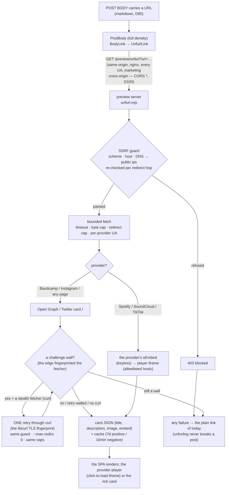

# Link Unfurling — a pasted link is a card, not a bare URL

`share-preview.md` decides what happens when a web10 link **leaves** the app
(crawler → OG card). This doc decides the other direction: what happens when a
link **enters** a post body. A link pasted into a post (the link-curation
groups — New Music, Reading Links, Shorts) unfurls into a rich attachment:
the provider's embedded player, or a preview card (title, description, image,
domain) — not an underlined text link.

## The use case

A curator drops `https://open.spotify.com/track/…` into the New Music group.
Today it renders as bare underlined text — the group looks broken next to the
YouTube links that do unfurl (the only provider the client knows). The fix is
the standard social behavior: every pasted link that can be resolved gets a
card or a player; the one that can't stays a clickable plain link, exactly as
before. Unfurling is **read-side only** — it never touches posting.

## The rule

> **The social app's preview server fetches the link; the SPA renders the
> card.** The SPA cannot fetch an arbitrary page's Open Graph tags (CORS),
> so the fetch is server-side — in the SOCIAL APP'S OWN preview server
> (`marketing/web10-social/preview/unfurl.mjs`), the same process that
> renders the crawler share cards. D60: the node stays 100% generic — it
> never learns "Spotify", "article preview", or any provider. The card is
> the social app's tail, exactly like the share card (`card.mjs`).

**The fallback is the floor.** A link that cannot be unfurled — bot-walled
(both fetchers), dead, private, truncated, blocked by the SSRF guard,
rate-limited — posts and renders as a clickable plain link, exactly as before
this change. An unfurl failure is never a rendering failure. The one
documented provider floor: **Instagram Reels have no inline playback** — no
keyless oEmbed + `x-frame-options: DENY` on their own `/embed` pages (the
D101 evidence); the rich card is the honest end state there.

## The endpoint

`GET /preview/unfurl?url=<encoded>` on the social app's origin. nginx proxies
it to the preview server for **every** user-agent (it is the SPA's own
same-origin JSON endpoint, not a crawler surface — the one non-crawler route
in the social nginx; `location = /preview/unfurl`). Response envelope:

| Outcome | Status | Body |
|---|---|---|
| Card found (network or cache) | 200 | `{ ok: true, card: {url, domain, provider, title, description, image, embed: {src, height, width, allow} \| null} }` |
| Not an http(s) url | 400 | `{ ok: false, reason: 'invalid_url' \| 'missing_url' }` |
| The SSRF guard refused it | 403 | `{ ok: false, reason: 'blocked' }` |
| Fetch failed / no metadata / rate-limited (5xx) | 200 / 429 | `{ ok: false, reason: 'unavailable' \| 'no_metadata' \| 'rate_limited' }` |

The SPA's client (`src/lib/unfurl.ts`) treats anything but `200 + ok:true` as
"plain link", single-flights concurrent mounts, pins only successes in the
session cache (failures retry on the next mount — the server's own TTLs do
the real caching), and re-checks the embed iframe's host against its own
per-provider allowlist (the two-sided embed gate — the server allowlists in
`unfurl.mjs`, the client in `unfurl.ts`; a card whose `embed.src` points
anywhere else renders as a rich card, never an iframe).

## The second consumer: the marketing site (D100)

The marketing site (`marketing/marketing-ui`, the anon `/trending` board + the
group detail pages) renders the SAME post bodies through the shared
`@web10/discover` card. A bare underlined URL there looked broken next to the
social app's cards (operator, 07.11.2026: "the social app looks like this but
the marketing page is just some links"), so the marketing board unfurls too —
from the SAME endpoint, cross-origin.

- **No node change (D60):** the fetch still lives in the social app's preview
  server. The marketing site is a read-only consumer of the same `GET
  /preview/unfurl` — it asks `${SOCIAL_ORIGIN}/preview/unfurl?url=…` and the
  SSRF guard + cache + damper all still apply (the marketing origin adds no
  new fetch surface; it just lets a second browser read the answer).
- **CORS, not a boundary:** the preview server answers the unfurl route with
  `Access-Control-Allow-Origin: *` (card metadata is public and
  credential-free — no session, no cookies, no token in or out). CORS only
  lets the browser READ the same answer a server-side caller already gets;
  the security boundary remains the SSRF guard + the per-IP damper, exactly
  as before (D99). The social app's own SPA asks same-origin, so the header
  is inert for it.
- **One renderer, two apps:** the unfurl render (the deterministic YouTube /
  Vimeo players, the provider oEmbed player, the rich OG card, the plain-link
  floor) moved to the shared package — `shared/discover/src/{unfurl.ts,
  UnfurlLink.tsx, linkEmbeds.ts}` — a verbatim tail of the social app's
  `src/lib/unfurl.ts` + `src/components/Feed/LinkEmbed.tsx`. The social app
  keeps its own copy for the full-density feed (unchanged); the marketing
  board + group pages use the shared copy. `MarkdownText` grows an opt-in
  `unfurlEndpoint` prop; `DiscoverCard` grows an opt-in `unfurlEndpoint`
  prop. Absent (the default — comments, the Top 10 rail, the tile captions,
  the repost embeds) → the plain link, the D99 density rule: block cards
  only at full density.
- **The caption link-out moves:** in remote (marketing) mode the caption is
  a link-out to the post on web10 social. When the caption carries an
  external link it UNFURLS, so the card / player must not nest inside that
  `<a>` (interactive content in interactive content is invalid HTML). The
  rich caption drops the wrapper and the post's link-out moves to the TITLE
  instead. A caption with no external link keeps the wrapper, exactly as
  before.

The marketing client (`shared/discover/src/unfurl.ts`) mirrors the social
client: single-flight, session-pinned-on-success, the two-sided embed-host
re-check, and the plain-link floor on every failure.

## The SSRF guard (the load-bearing part)

The endpoint fetches an **attacker-influenced** URL. The guard, in order:

1. **Scheme + shape**: http(s) only; no credentials in the url; no
   single-label hostnames (the docker service names — `api`, `clickhouse` —
   and mDNS records are single-label and reserved); `localhost` / `*.local` /
   `*.internal` refused by name.
2. **Address**: an IP literal is judged in place; a name is resolved
   (`dns.lookup all+verbatim`) and **every** resolved address must be public —
   loopback, RFC1918, CGNAT (100.64/10), link-local (169.254/16, the cloud
   metadata range), TEST-NET, benchmarking, multicast, reserved, and the
   IPv6 twins (`::1`, `fe80::/10`, `fc00::/7`, `ff00::/8`, `2001:db8::/32`,
   `64:ff9b::/96`, the IPv4-mapped/compatible forms judged by their embedded
   address) are all refused. A host answering with even one private address
   is ambiguous → refused.
3. **Redirects**: fetched with `redirect: 'manual'`, ≤ 5 hops, and **each hop
   re-runs the full guard** (the redirect-to-127.0.0.1 escape is the classic
   SSRF; a Location header is attacker data).
4. **Bounded**: 8s timeout per page hop (6s oEmbed), 750KB body cap (the cap
   hands back what it read — the preview tags live in the `<head>`, the first
   bytes — so a truncated 800KB shell still unfurls), one fetch per unique
   URL (the cache: 7-day positive, 10-minute negative; blocked verdicts are
   stable and cached long).
5. **Abuse dampening**: 60 requests/min per client IP (the rightmost
   X-Forwarded-For entry, the one nginx appended) → 429. A soft damper, not
   the boundary — the guard above is the boundary.

**The residual (documented, not hidden):** the guard resolves-then-fetches, so
a DNS-rebinding window exists between the check and the connection (a host
that answers public at check time and private at connect time). The mitigations
are the short negative TTL, the per-hop re-check, and the fact that the
preview server is the web edge of the social container — not the node: a
rebind that slipped through can read a public address from *inside* the box,
never user data (the preview server holds no credentials and reads only
anon-public docs). See the scan record:
`security/scans/2026-11/link-unfurl-ssrf.md`.

## The provider matrix (verified live, 07.11.2026; the D101 round 08.11.2026)

| Provider | Mechanism | The card | Verified |
|---|---|---|---|
| YouTube / Vimeo | client-side `parseEmbed` (unchanged — no round-trip) | the playable player of today | pre-existing (the control) |
| Spotify | `open.spotify.com/oembed` (keyless) | the **player** (152px iframe, click-to-load) + the cover art + title | ✓ live (the task URL) |
| SoundCloud | `soundcloud.com/oembed` (keyless; `api.` subdomain is 401) | the **player** (≤320px) + title + author + artwork | ✓ live |
| TikTok | `tiktok.com/oembed` (keyless; player-only answer) | the **player** (325×578 portrait, capped + centered; `autoplay`/`muted` stripped so it click-loads like the YouTube Shorts pattern) | ✓ live (oEmbed) |
| Instagram Reels | the page fetch with the **crawler UA** (a browser UA gets the login wall; the bot shell carries `og:image` + the meta description). **Inline playback is provider-blocked** (the D101 evidence, 08.11.2026): no keyless oEmbed (`graph.instagram.com/oembed` → "Invalid OAuth 2.0 Access Token"; `api.instagram.com/oembed` → dead) and the `/embed/` + `/embed/captioned/` pages send `x-frame-options: DENY` (the browser refuses to iframe them; they also serve a login shell to anon fetchers) | the **rich card** (the reel's thumbnail + "Name … on Instagram: caption" + likes/comments description) — the floor, documented, not silent | ✓ live |
| Bandcamp | the page fetch (a browser UA — the crawler UA gets the edge's "Client Challenge" wall, verified) **+ the challenge-wall stealth retry (D101)**: the edge fingerprints the TLS CLIENT — Node's built-in fetch (undici) gets the "Client Challenge" wall while a libcurl client gets the page (reproduced live 08.11.2026 from residential AND datacenter hosts). On a detected wall the page fetch retries ONCE through a curl subprocess (`makeCurlStealthFetch` — inside the same guard: re-validated url, `--max-redirs 0`, `--max-time`, the byte cap still enforced by guardedFetch) | the **player** when `twitter:card=player` + `twitter:player` (the EmbeddedPlayer iframe, at the player's DECLARED `twitter:player:width/height` — a size=large track player is 350×467; the page's `og:video:height` (120) is only the fallback — the mismatch would clip the iframe), else the **rich card** (the cover + "Track, by Artist") | ✓ live (08.11.2026: the operator's plantasia url — undici walled, the curl retry cleared it, the 467×350 EmbeddedPlayer card) |
| any other page (articles, Substack, …) | the page fetch with the browser UA → `og:` → `twitter:` → `<title>` / meta description / first `
` / first-prose fallback (legacy no-`
` HTML: the title echo + date stamp drop, whole sentences to ~200 chars) + `og:image` → `twitter:image` → first real `` (gifs / 1×1 / pixel patterns skipped, relatives resolved) | the **rich card** (16:9 image banner when there is one, favicon + domain row, title, 2-line description) | ✓ live (paulgraham.com — the task URL — and stratechery.com) |

The page fetch wears a **browser UA by default** (several edges — Bandcamp's —
actively challenge link-preview bots while serving real browsers the full
page); the crawler UA is a per-provider override (`CRAWLER_UA_OVERRIDES`,
Instagram today). A bot-challenge wall ("Client Challenge", "Just a moment…",
the `_fs-ch-` asset path) gets the **stealth retry** (one curl attempt, the
libcurl TLS fingerprint the challenged edges accept — D101); a wall that
survives the retry (or no curl in the container) is refused as
`no_metadata` — the plain link is the honest card, never a wall-shaped card.
The retry is a transport swap, not a second boundary: the url is re-validated
by the guard before the spawn (scheme/shape/DNS-public), curl follows no
redirect (`--max-redirs 0` — the Location comes back and the per-hop loop
re-validates it exactly as the default fetcher's), the transfer is time- and
byte-bounded, and the binary runs via `execFile` (an argument array — no
shell, the validated url is never interpolated).

## The card, in the body

The read side is `PostBody`'s `BodyLink` (D85's one locked renderer): an
embeddable local provider (YouTube/Vimeo) renders its player **unchanged**;
an external http(s) link at **full density** renders `UnfurlLink` (`LinkEmbed.tsx`):

- **loading / failed** → the plain link of today (`PlainExternalLink` — one
  source for the fallback so it can't drift);
- **`card.embed`** → `PlayerEmbed` — two presentation patterns (D102, the
  operator's 08.11.2026 pass: the audio providers must not read as native
  web10 music posts):
  - **PORTRAIT video players (TikTok)** keep the click-to-load poster pattern
    (the YouTube Shorts shape — a video, so a play affordance reads
    correctly): the poster + the centered play button, the allowlisted
    provider iframe on tap, capped at the provider's width and centered.
  - **AUDIO provider embeds (Spotify / SoundCloud / Bandcamp — the
    landscape players)** show the **provider's player WITHOUT a click** (the
    old web10-styled music bar + a fake play button "read as a native web10
    track" — the exact complaint). Instead: the provider-identity chrome
    (the artwork + the title + the description + the provider's domain with
    its favicon — it says "the player is from spotify.com", never "this is a
    web10 track") and the allowlisted provider iframe loads when the embed
    **scrolls into view** (the `IntersectionObserver` is the performance
    gate — a feed can carry many embeds; 200px rootMargin so an embed at the
    viewport edge is ready by the time it is seen). No IntersectionObserver
    (the test env / very old engines) → the iframe loads immediately. The
    two-sided iframe allowlist still gates the src (unchanged); only the
    trigger moved from the click to the scroll.
- **else** → `RichLinkCard` — the whole card is the link (`target="_blank"`):
  optional 16:9 image, the favicon + domain row, the title (2-line clamp),
  the description (2-line clamp).

**Light / inline densities never unfurl** (repost quotes, the profile
captions, the ad copy — a block card in a `line-clamp` teaser would blow the
teaser up; they keep the plain link, as do DMs' `TextWithLinks` chips).
The unfurl is a content-driven pop-in (the card replaces the URL line when it
arrives — the Facebook model); with the server cache + the session cache,
repeat views resolve in one same-origin round-trip. Tokens only
(`surface` / `border` / `brand` / `muted-foreground`), `data-testid`
hooks (`unfurl-card`, `unfurl-player`, …), `ReliableImage` for the card
artwork (the favicon is the one documented local-only exception — decorative,
hides on failure).

**Existing posts pick it up for free.** The unfurl is computed at read time
from the URL already in the post's markdown — no write, no backfill: the two
plain-text seed posts in New Music / Reading Links render their cards the
first time they are viewed after deploy.

## What this is not

- **Not a node endpoint.** The node never fetches external URLs and never
  learns a provider (D60). The generic "URL → card" primitive could later
  move to the node for a second consumer (the ad-creative need,
  `strategy/ads-october/needs/ad-creative-labor.md`) — today the social app
  owns its own tail. The marketing site (D100) is a CONSUMER of that tail
  (cross-origin, CORS), not a home: the fetch still deploys with the app it
  renders.
- **Not a media re-host.** The card references the provider's URLs (the
  oEmbed iframe, the CDN artwork). Nothing is downloaded into web10 storage.
- **Not a privacy loosening.** A post's links are content the post already
  shows; the fetch reads only what the linked page serves to a fetcher. No
  token, no cookie, no user data leaves the SPA in the unfurl request
  (same-origin, URL only).
- **Not ad unfurling.** Ad copy renders through `PostBodyInline` (light) —
  the plain link; the ad-creative product-card need stays its own lane.

## Files

- The server logic: `marketing/web10-social/preview/unfurl.mjs` (the guard,
  the guarded fetch, the provider dispatch, the cache — pure, injectable
  `doFetch`/`lookup`/`stealthFetch` seams; the challenge-wall stealth retry +
  the curl fetcher `makeCurlStealthFetch` — D101).
- The transport + the route + the rate limit + the CORS answer:
  `marketing/web10-social/preview/server.mjs` (`GET /preview/unfurl`,
  `Access-Control-Allow-Origin: *` on every verdict + the OPTIONS preflight —
  the marketing second consumer reads it cross-origin); the nginx split:
  `marketing/web10-social/nginx.conf` (`location = /preview/unfurl` — every UA).
  The container: `marketing/web10-social/Dockerfile` (`apk add curl` — the
  stealth retry's binary; absent curl the wall verdict stands, the floor).
- The client seam: `marketing/web10-social/src/lib/unfurl.ts` (the candidate
  check, the same-origin fetch, the session cache, the embed-host re-check).
- The render: `marketing/web10-social/src/components/Feed/LinkEmbed.tsx`
  (`UnfurlLink` / `PlayerEmbed` / `RichLinkCard` / `PlainExternalLink`) +
  `PostBody.tsx`'s `BodyLink` (full density only).
- The shared tail (the marketing second consumer, D100):
  `marketing/shared/discover/src/unfurl.ts` (the client seam, endpoint-
  parameterized) + `src/UnfurlLink.tsx` (the renderers, the shared `ReliableImage`)
  + `src/linkEmbeds.ts` (the deterministic YouTube / Vimeo id parse), wired
  into `src/MarkdownText.tsx` (`unfurlEndpoint` prop) and `src/DiscoverCard.tsx`
  (`unfurlEndpoint` prop — the rich caption + the title link-out); the wiring
  in `marketing/marketing-ui/src/pages/GroupDetail.tsx` (the group's posts).
  D111 retires the marketing feed and its unfurl wiring, not this group consumer.
- Tests: `src/__tests__/previewUnfurl.test.ts` (the module — the guard
  replayed, the provider matrix, the cache), `src/__tests__/previewServerUnfurl.test.ts`
  (the real process over the wire — the exploit urls denied before any fetch;
  the CORS verdicts + the preflight), `src/__tests__/lib/unfurl.test.ts` (the
  client seam), `postBody.test.tsx` (the render states); the marketing side:
  `marketing-ui/src/components/GroupUnfurl.test.tsx` (the retained group-page
  provider player and configured social endpoint). Board-only marketing tests
  retired with D111; shared/social rendering coverage remains in its own suites.
- The SSRF scan record: `security/scans/2026-11/link-unfurl-ssrf.md`.
- The harness: `screenshots/harness/mock-unfurl.ts` (the canned cards) + the
  two link-only seed posts in `mock-data.ts` (`fp-unfurl-spotify`,
  `fp-unfurl-article`).

## Open

- **Bandcamp — CLOSED by the stealth retry (D101, 08.11.2026).** The edge
  challenged the undici TLS fingerprint → the "Client Challenge" wall →
  `no_metadata` → the plain link. The wall now gets ONE curl retry (the
  libcurl fingerprint the edge accepts — reproduced live: the operator's
  plantasia url walls undici and unfurls to the 467×350 EmbeddedPlayer via
  the retry). **The residual:** the retry is bounded (one attempt, the
  default fetcher stays primary) and the edge could start challenging curl
  too (a fingerprint chase) — that re-degrades to the plain link (the floor),
  and it is detectable in the logs (`challenge wall … still walled`).
- **Instagram Reels — the inline-playback floor (D101, 08.11.2026).** No
  keyless oEmbed (`graph.instagram.com/oembed` requires an OAuth token;
  `api.instagram.com/oembed` is dead) and the provider's own `/embed/` +
  `/embed/captioned/` pages send `x-frame-options: DENY` (+ serve a login
  shell to anon fetchers) — the rich card is the honest end state. Re-visit
  only if Instagram ships a keyless oEmbed (the oEmbed dispatch is the
  existing seam).
- **The ad-creative consumer** (`ad-creative-labor.md` /
  `external-link-embeds.md`): the same primitive, later — its "where does the
  fetch live" question is answered by this build (the social app's preview
  server, D60-clean).
- **Deploy + the live groups**: the test groups (New Music / Reading Links /
  Shorts) verify on the deployed app — the provider matrix above is the local
  proof. The marketing board (D100) rides the SAME endpoint, so its live
  verification is the social app's deploy: a marketing build against an
  undeployed social app degrades to the plain links (the floor), never to a
  broken card. The D101 round: the existing posts (Plantasia, the NASA reel)
  pick up the fix at READ TIME — the 10-minute negative cache expires, the
  wall retry runs, the card lands. No backfill.
